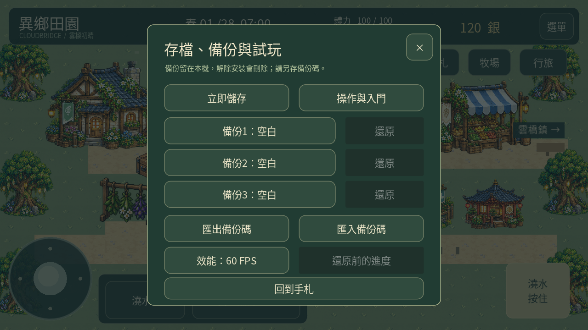
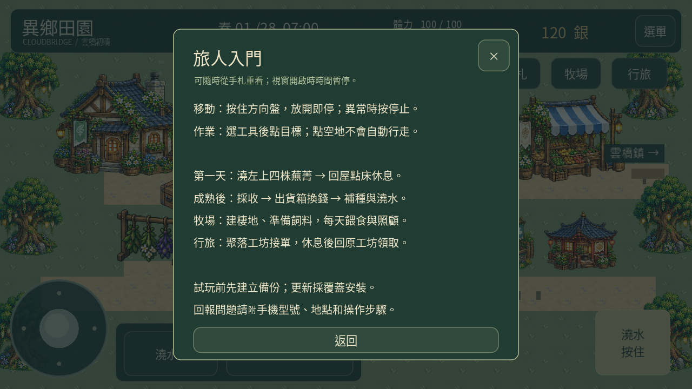
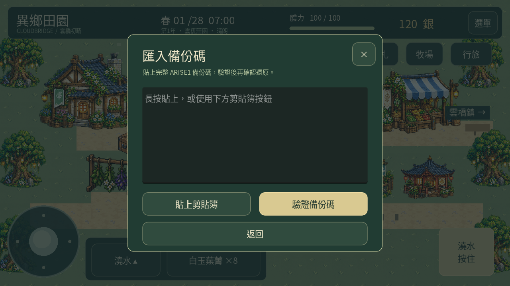

# 異鄉田園 0.23「旅人手札」

[下載 Android APK](https://github.com/SugarSaiyajin/ARISE/raw/refs/heads/delivery/android-0.23.0/arise-0.23.0.apk)

Android 7.0+、ARM64、OpenGL ES 3.0。請覆蓋安裝保留進度，不要先解除安裝。

入口：右上選單 → 存檔與試玩設定。

- 三個獨立手動備份、還原確認與還原前進度保留。
- 備份碼匯出／匯入，可另貼到自己的筆記保存。
- 可重看入門、30／60 FPS 選項。
- 延續0.22的美術、觸控與生活系統。

本機備份在解除安裝時也會刪除；請另外保存完整備份碼。沒有雲端同步。

[操作說明與限制](GUIDE.md) · [測試報告](test-summary.json) · [更新相容檢查](update-compatibility.json) · [APK驗證](validation.json)

3259項不重複檢查通過，另有桌面／觸控完整流程與12個音訊檔檢查。120個遊戲日的加速存檔重載測試通過；這不是手機效能測試。實體Android的剪貼簿、軟鍵盤及耗電／發熱仍待試玩。

原始碼分支：feature/traveler-backups-0.23，實作提交 f1099f5。

以下為桌面Godot觸控模式實際渲染：

