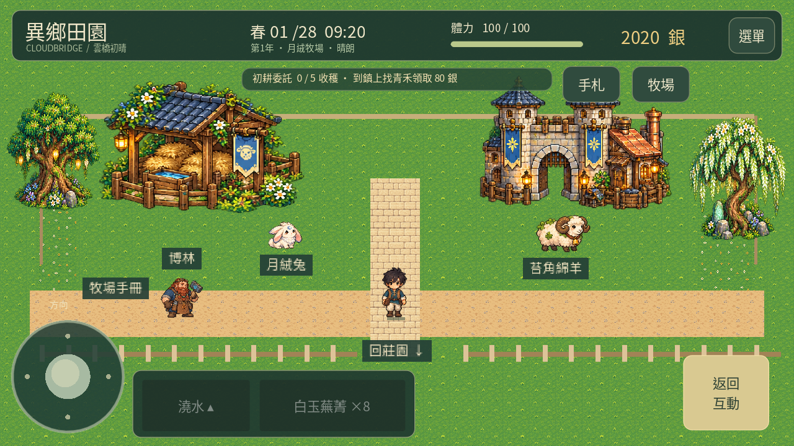
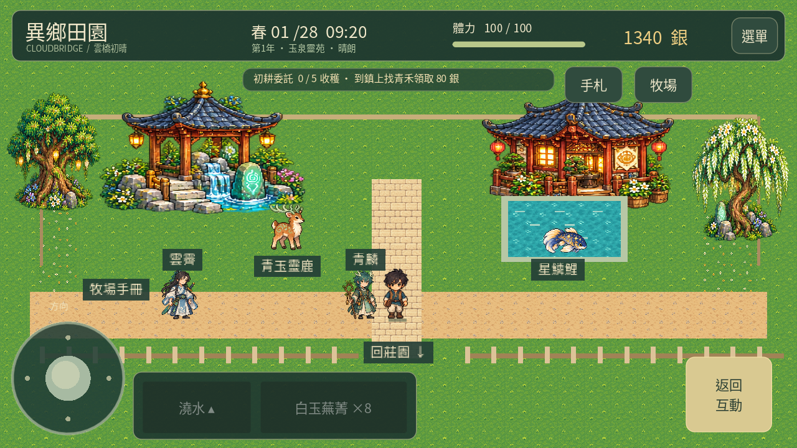
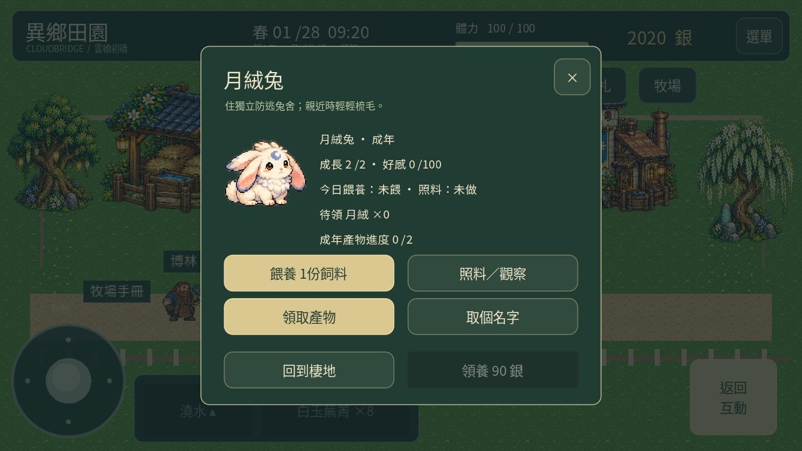
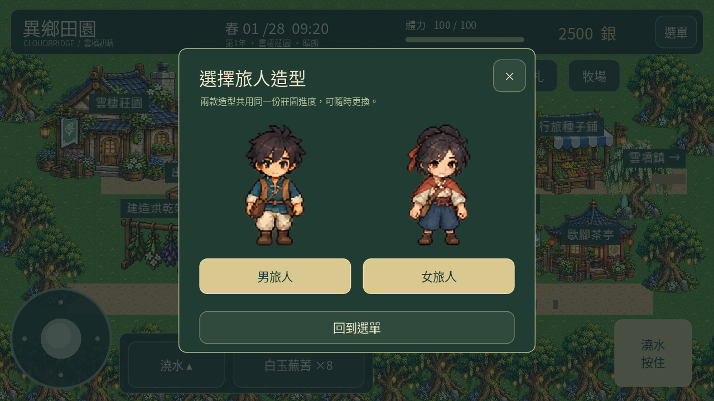

# 異鄉田園 · 雲橋靈牧 0.21

[下載 Android APK](https://github.com/SugarSaiyajin/ARISE/raw/refs/heads/delivery/android-0.21.0/arise-0.21.0.apk) · [操作說明與養殖規則](GUIDE.md)

Android 7.0+、ARM64、OpenGL ES 3.0。與 0.14 套件及簽章相同、版本碼提高，可直接覆蓋安裝；**請勿先解除安裝，以免刪除存檔**。0.21 尚待用戶實體手機試玩確認。

## 本版可玩內容

- 八種養殖生物、四組可走動棲地、建造與領養、命名、幼體成長、餵養與照料、產物領取與出貨。母雞保留既有進度。
- 男／女旅人造型可切換並保存；九位居民新造型，新增六位奇幻居民的對話與每日好感。
- 新建築、農具、動物與地表。手機方向控制從112放大至148，補上全域放開、失焦重置及手動取消尋路；手機空白地面點擊不再啟動尋路。
- 同時包含先前開發的八種作物、28日春季、居民作息與春季第一章。

右上角 **牧場** → 選棲地 → 點牧場手冊建造；新棲地需木材4／石料2／40銀。飼料10份20銀；母雞沿用收成小麥。到農舍睡眠後結算成長與產物，領取後可回莊園出貨。

## 實際遊戲畫面

以下由 Godot 直接渲染，使用獨立展示狀態呈現成年動物，非新存檔免費贈送全部動物。

[莊園](farm.png) · [家禽庭院](habitat-0.png) · [桑蜜小院](habitat-2.png) · [女旅人](female.png) · [居民對話](visitor.png) · [產物行囊](products.png)

## 驗證

2693項不重複檢查通過（其中觸控與場景另在手機版面重跑），桌面與手機完整流程均通過，12個音訊檔通過。APK簽章、完整性、16KB ZIP／ELF對齊、零權限及開發檔案排除均通過。手機上實際觸控穩定性、效能與發熱仍待試玩。

[APK驗證](validation.json) · [覆蓋更新相容性](update-compatibility.json) · [測試摘要](test-summary.json) · [檔案校驗碼](SHA256SUMS.txt)
