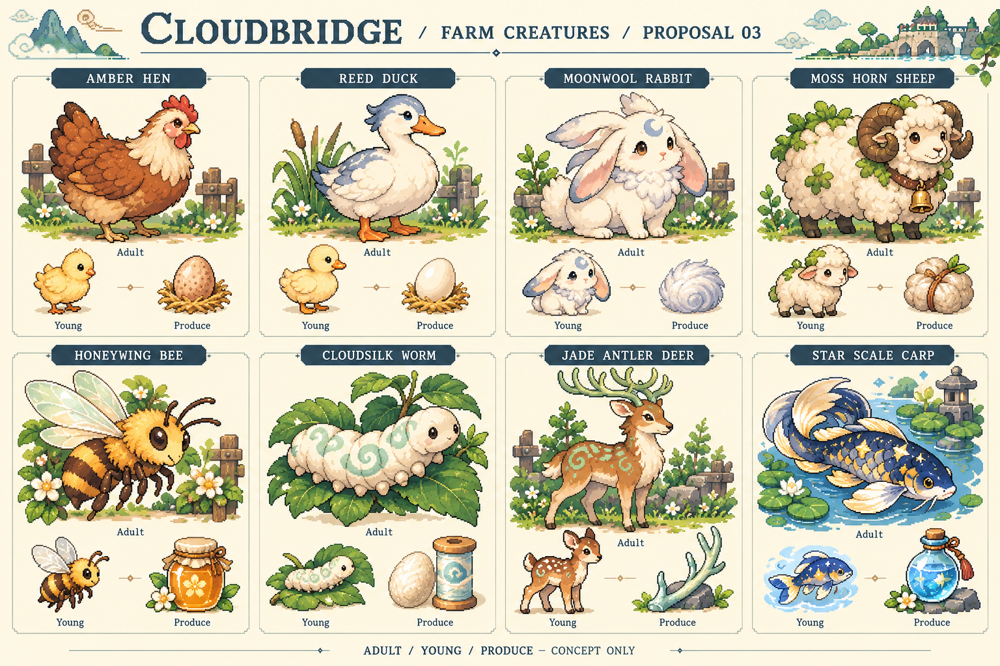
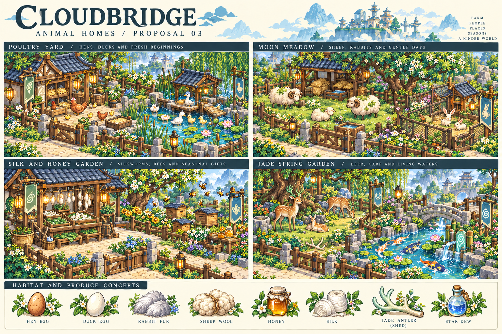

# 養殖生物提案 03（待審核）

2026-10-21。用戶已通過男女主角與提案 02 的奇幻／玄幻角色、場景及道具。本次只新增養殖生物與棲地設計，尚未獲核准；不修改遊戲、不替換素材、不建置新 APK。

## 八種養殖生物

| 類型 | 名稱 | 外觀重點 | 產物構想 | 照料與棲地構想 |
|---|---|---|---|---|
| 田園 | 琥珀雞 | 赤褐羽、奶油色頸羽與紅冠 | 雞蛋 | 穀物、飲水、巢箱與放養庭院 |
| 田園 | 蘆羽鴨 | 白羽、灰藍頂羽、橙嘴與蹼足 | 鴨蛋 | 穀物、淺水塘、乾燥休息棚 |
| 西方奇幻 | 月絨兔 | 奶白長耳、額頭月紋、銀藍絨毛 | 梳理收集的月絨 | 牧草、蔬菜與獨立防逃圍欄；可撫摸梳毛 |
| 西方奇幻 | 苔角綿羊 | 奶油捲毛、苔綠毛簇、彎角銅鈴 | 羊毛 | 草場、乾草、飲水與遮蔭棚；定期剪毛 |
| 西方奇幻 | 蜜翼蜂 | 琥珀條紋、半透明葉形翅 | 花蜜蜂蜜 | 花圃與蜂箱；花卉類型可作為蜂蜜差異的設計方向 |
| 東方玄幻 | 雲錦蠶 | 玉白軟身、淡青雲紋 | 雲錦絲 | 桑葉、蠶盤與通風蠶房；蠶繭與紡織加工 |
| 東方玄幻 | 青玉靈鹿 | 茶褐斑紋、淡玉枝角 | 自然脫落的玉角 | 較大草地、林蔭、水槽與安靜互動；玉角非每日產物 |
| 東方玄幻 | 星鱗鯉 | 靛藍金鱗、星點與流尾 | 靈池凝結的星露 | 清水池、魚食與水質照護；星露非從魚體採取 |

## 四組飼養環境

1. **家禽庭院**：雞舍、鴨棚、巢箱、穀物槽與蘆葦淺塘。
2. **月絨牧場**：綿羊草場與分隔的兔舍活動區；設水槽、草料架與遮蔭。
3. **桑蜜小院**：桑葉蠶房與分開的花圃蜂箱，留出工作通道。
4. **玉泉靈苑**：靈鹿林地與獨立鯉池，結合石渠、竹木與溫和靈紋裝置。

## 養成方向（提案，未實作）

以命名、餵食、清潔、撫摸或觀察、成年成長及關係回饋為核心。不同物種具有不同日常；蜂蠶使用群體飼養，魚類使用魚池互動，不一律套用家禽的撫摸方式。產物連結料理、紡織、農具工藝及靈植照護，具體週期、成本與數值留待玩法設計。

圖像為概念提案，不是正式遊戲圖集。正式製作時需統一視角、尺寸與顏色，補齊走動／休息／進食等狀態；蜂的幼體須按卵、幼蟲、蛹、成蜂設計，概念卡的小型蜂不作生物學幼體定稿。場景圖用於確認棲地氛圍，正式手機地圖會簡化裝飾，確保門口、操作空間與可點目標清楚。

本批八種生物及四組棲地待用戶審核後再安排正式素材與遊戲整合。
