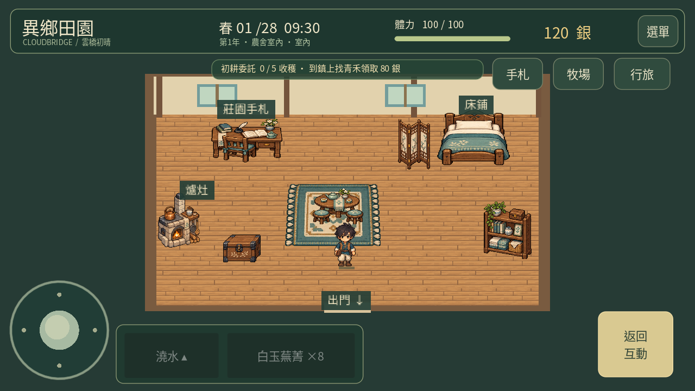
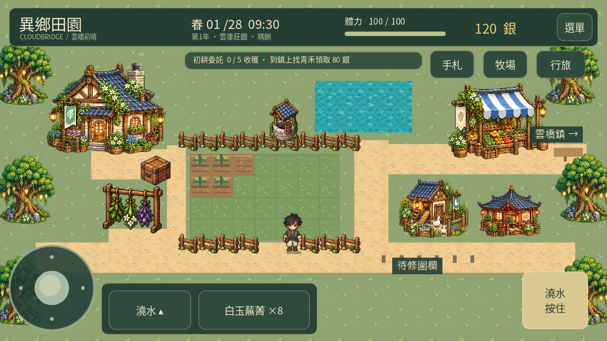
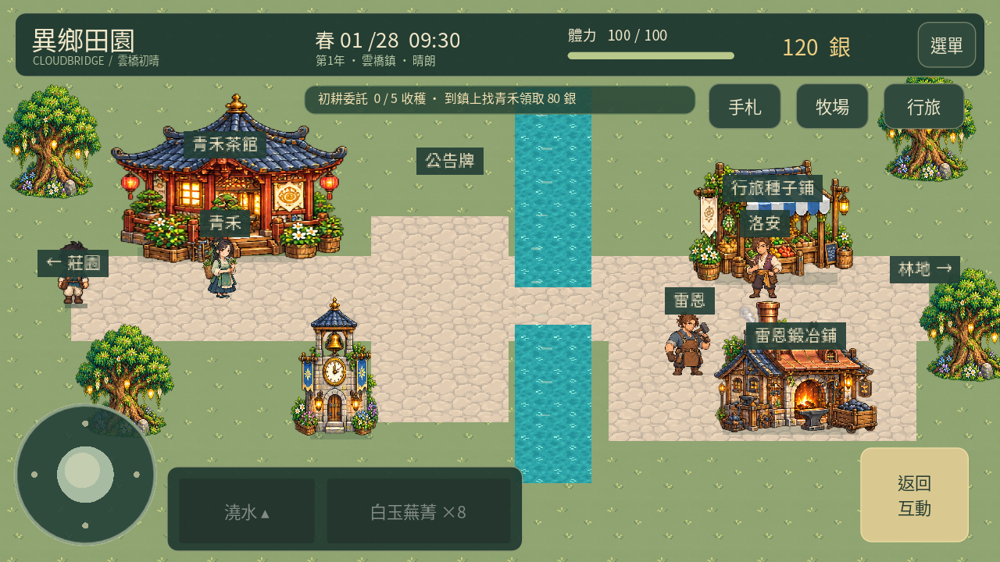
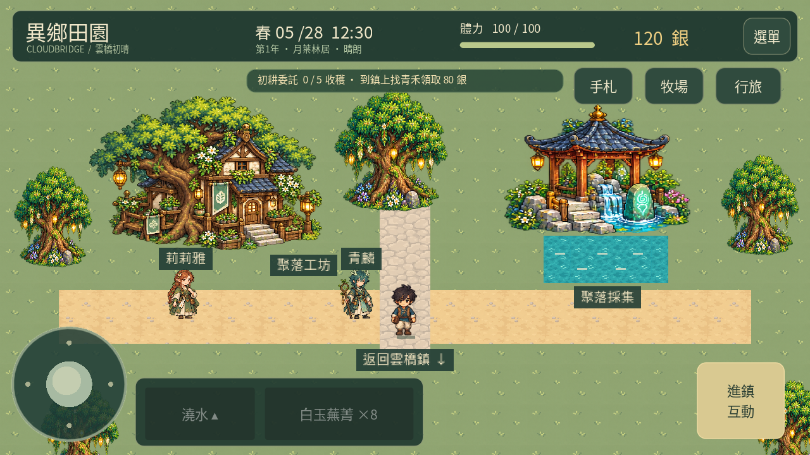

# 異鄉田園 · 雲橋共作 0.22

[下載 Android APK（約99 MB）](https://github.com/SugarSaiyajin/ARISE/raw/refs/heads/delivery/android-0.22.0/arise-0.22.0.apk) · [實際引擎示範影片（約18秒）](https://github.com/SugarSaiyajin/ARISE/raw/refs/heads/delivery/android-0.22.0/gameplay.mp4) · [完整操作與配方](GUIDE.md)

與0.21套件、簽章相同，版本碼由21提高到22，可直接覆蓋安裝。**請勿先解除安裝，以免刪除存檔。** Android 7.0+、ARM64、OpenGL ES 3.0。新版觸控仍待用戶手機實測確認。

## 優先改善

- 搖桿控制權、全域放開、工具按鈕取消及「停止移動」。左手接觸搖桿期間，右手世界點擊不能奪走移動控制。
- 主角與居民呼吸及重心待機；只改繪製，不移動碰撞與存檔座標。
- 同風格農舍家具、農場分區與田邊主通道、低彩度小鎮地面。

## 第3至7步首輪可玩內容

- 動物漫步／停留／餵食／親近及晚間休息表現；幼體、餵養及待領標示。
- 分級棲地造價，統一兩個雞舍入口價格；好感20的新增物種每第4日一次免飼料回饋。
- 兩種作物／草葉飼料、五種加工成品、一次安裝的符玉灌溉器；三道養殖料理。
- 六位新居民的日常時段、每日物資委託及各自兩幕故事。
- 月葉林居、爐火守望、雲泉靈修院、星落共榮市集四個可走動聚落，有工坊與每日採集。

右上角「行旅」前往聚落及查看配方。晴天11至18時居民在聚落，其他時段或雨天在牧場。故事在交談後的「故事與委託」內，好感3開啟。工藝品需休息一日後回接單工坊領取；飼料在莊園立即製作。

## 實際畫面

[爐火守望](culture_ember.png) · [雲泉靈修院](culture_sanctuary.png) · [星落市集](culture_market.png) · [待機預覽](idle.png) · [加工配方](recipe.png) · [工藝行囊](crafts.png) · [居民故事](story.png) · [養殖照料](care.png)

圖片與影片由Godot直接渲染，展示使用獨立狀態，部分物資預備好以呈現流程，非新存檔免費贈送。固定幀率影片不作手機效能基準。

## 驗證

2985項檢查（按套件去除手機／桌面重跑計數），另有兩種完整場景流程及12個音訊檔通過。含209項工藝／居民進度與82項新場景／介面／Viewport事件檢查；工單、故事與每日限制皆測試重開及防重複領取。APK簽章、16KB ZIP與ELF對齊、完整性、零權限、開發檔排除均通過。

[APK驗證](validation.json) · [測試摘要](test-summary.json) · [覆蓋更新相容性](update-compatibility.json) · [檔案校驗碼](SHA256SUMS.txt)

[Godot原始碼](https://github.com/SugarSaiyajin/ARISE/tree/feature/cloudbridge-refinement-0.22)
