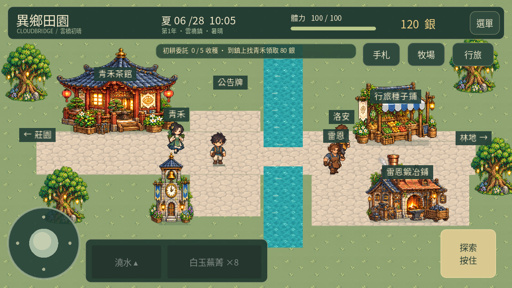

# 異鄉田園 · 雲橋初晴

ARISE 的 Godot 可玩原型：原創異世界、唐宋與西方中世紀融合的像素農耕生活遊戲。**目前為 0.27「雲橋日常」試玩版**，亦可使用鍵盤滑鼠。

Android 安裝與實機試玩步驟見 [手機試玩說明](docs/ANDROID_TESTING.md)。

使用者提供的 Godot 農場教學之取得狀態及專案適用性初評見 [教學對照評估](docs/TUTORIAL_REVIEW.md)；目前影片存取受阻，尚未完成內容核實。

本版更新：補齊九位居民四向步態與工作／交流／歇腳日程，加入三道夏季料理、季節委託與喜好、養殖日常提示、農舍收納及每日小歇，並統一牧場道路色調。詳見[0.27操作、驗證與限制](docs/LIVING_027.md)。手機實測修正暫緩，上架準備未開始。

[下載Android 0.27 APK](https://github.com/SugarSaiyajin/ARISE/raw/refs/heads/delivery/android-0.27.0/arise-0.27.0.apk) · [畫面與驗證紀錄](https://github.com/SugarSaiyajin/ARISE/tree/delivery/android-0.27.0)

## 啟動

使用 **Godot 4.6 或以上版本**，匯入根目錄的 **project.godot**，按 **F5** 執行專案。也可使用：

    godot --editor --path .
    godot --path .

沒有外部執行套件依賴。像素場景與角色採用原創 PNG 圖集搭配 GDScript 繪製；繁體中文字型已隨專案提供。

在雲端唯讀家目錄下，先將 Godot 的使用者目錄設為可寫位置：

    mkdir -p /tmp/arise-config /tmp/arise-cache /tmp/arise-data
    export XDG_CONFIG_HOME=/tmp/arise-config
    export XDG_CACHE_HOME=/tmp/arise-cache
    export XDG_DATA_HOME=/tmp/arise-data

## 試玩路線

1. 關閉開場指引。預設工具是「澆水」。
2. 點擊田地左上角的四株蕪菁，角色會自動走近並澆水。
3. 點擊左側農舍進屋，再點右上方床鋪，選「睡到明天」；醒來後點下方門口回莊園。
4. 選「採收」，點擊成熟的蕪菁；再點農舍右側「出貨」木箱，預覽清單後確認出貨換取銀幣。
5. 選「開墾」整理空地，再「播種」。底部種子按鈕可選擇八種作物。
6. 每天澆水後休息。新種的蕪菁、小麥、燈籠莓分別需要 2、3、4 個澆水日。
7. 沿莊園右側道路進雲橋鎮，到茶館找青禾；收穫五份作物後可領取一次性的 80 銀獎勵。過橋向東可買種子，南側可與鐵匠交談。莊園原有種子攤仍可使用。

8. 從小鎮東邊進霧杉林，點枯枝、石料或香草自動走近採集。背包可查看「採集素材」。木材 6、石料 4 可修復莊園南側圍欄；農舍爐邊消耗一份霧香草可恢復最多 20 體力。

9. 收集木材 4、石料 2 並準備 60 銀，點農舍南側「建造烘乾架」。放入 1 或 3 份收成，睡一晚後回架上領取，再到出貨箱出售。

10. 在小鎮公告牌接居民委託，備齊物品後找本人確認交付；每天最多完成一件，已接委託可跨日保留。青禾好感達 3 後，交談可赴窗邊茶會。

11. 備齊木材 8、石料 6、100 銀，在莊園水井南側建造雞舍；母雞每隻另付 80 銀。小麥種植三個澆水日後採收，用來餵雞；睡一晚後回雞舍領蛋，出貨每顆 56 銀。

12. 完成兩件居民委託，備齊木材 6、石料 4、160 銀，前往霧杉林東側修復驛路。進入星潮舊驛查看石台，收藏殘片可獲三種種子各 3 包、120 銀，獎勵只領一次。

13. 收集木材 4、石料 2、80 銀，點任一釣點製作魚竿。投竿後等浮標下沉，再點「收線」；每竿耗 2 體力，每天最多釣到三尾。背包「魚獲」可查看庫存，莊園出貨箱可出售。

14. 點農舍左側爐灶 → 料理食譜，可做白玉香草湯、金穗煎蛋餅與霧香烤鯽。料理放入背包，可在任一地圖食用；滿體力不消耗，出貨與睡眠會保留。

初始四株蕪菁是莊園遺留作物，已有一天成長，澆水後只需睡一晚就能成熟。

| 操作 | 桌面 | 手機 |
|---|---|---|
| 移動 | WASD／方向鍵、點地面 | 左側搖桿、點地面 |
| 工具 | 1 開墾、2 播種、3 澆水、4 採收 | 底部工具列 |
| 互動 | E；或點田地、建築、人物 | 右側情境按鈕；或直接點目標 |
| 換種子 | Tab／點種子按鈕 | 點種子按鈕 |
| 背包 | B／選單 | 選單 → 背包 |
| 存檔 | F5／選單 | 選單 → 存檔與試玩設定 → 立即儲存 |
| 暫停 | Esc／選單 | 選單 |
| 釣魚收線 | 空白鍵／E／點收線 | 點收線 |

主角支援八方向圖像，斜向與直向等速，交界面向有緩衝。選單的「角色外觀」可查看放大圖與動作。工具成功操作後站定約 0.30 秒；期間可先點下一個目標，完成後出發。開啟對話或選單會暫停時間；切到背景會儲存並暫停。支援搖桿與工具按鈕同時使用的多指觸控；右側作業按鈕可按住連續使用。Android 返回鍵可開關選單。

## 本版規則

- 28 格田地、三種作物、種子商店、出貨、背包、青禾好感與初耕委託、商人洛安及鐵匠雷恩。洛安提供種子交易，雷恩目前提供故事對話。
- 遊戲日 07:00–22:00，現實一秒對應遊戲一分鐘，完整白天約 15 分鐘。可隨時回農舍點床鋪提早睡覺；夜深時會自動回屋休息。
- 每四天一場雨；雨水自動澆灌田地。乾旱作物暫停生長，不枯死。
- 開墾／澆水消耗 2 體力，播種／採收消耗 1；睡眠恢復至 100。
- 與青禾每天第一次交談增加 1 好感，蕪菁委託另加 1；達 3 後可參加一次窗邊茶會，完成獲得霧香草 2 與好感 1。手札可重讀，沒有重複獎勵，也尚未加入戀愛系統。
- 居民委託三日輪替，每天最多完成一件，同時只能接一件；已接委託不過期，可在公告牌確認放棄。
- 霧杉林每天有 8 處採集點，合計木材 6、石料 4、霧香草 3，全部採集消耗 23 體力；重新進入或讀檔不會更新，睡醒後才更新。素材不會被出貨箱出售。
- 烘乾架每批隔日完成，投入與成品 1：1，一次最多 3 份；成品留在架上直到領取，雨天也照常加工。出貨箱出售所有作物與已領取成品，保留林地素材。
- 雞舍最多三隻母雞，每隻每天吃一份小麥收成，隔日產一顆蛋；未餵食不會死亡。巢箱上限 24 顆，餵食前檢查隔日空間；雞蛋領取後才可出貨。
- 舊驛路修復後永久開放，可往返林地與遺跡；碑文可反覆讀取，星紋殘片以手札紀錄收藏，發現獎勵只領一次。
- 魚竿永久保留；三處釣點共用每天三尾上限，睡醒更新。過早、逾時、關閉或切到背景均無魚獲，已消耗體力不退還。
- 三種料理各恢復最多 35／45／40 體力，每次食用一份。製作需在農舍、備齊收成與指定食材，無需銀幣、體力或跨日等待。
- 日期持續累加，目前只顯示春季，尚未實作換季、其他養殖動物、戰鬥或角色作息。

## 存檔

存檔為 Godot 的 **user://farm_save.json**，每 30 秒、成功使用田間工具、切換地圖、採集、修復、煮茶、建造、投料、領取、接單、放棄、交付、完成茶會、雞舍建造、買雞、餵食、領蛋、修復驛路、收藏殘片、睡眠、交易、交談、正常關閉及切到背景時儲存。選單也能手動存檔。系統強制終止前不保證能收到通知，最近一次自動存檔之後的進度可能遺失。

0.22 沿用版本 1 存檔，新增可選的 life 欄位，並保留 ranch、hero_style 與春季進度欄位；舊版缺少的新欄位採預設值，保留既有母雞、巢箱、雞蛋與莊園進度。田間成功操作立即保存，動作與待出發點擊不存檔，重開不會卡住或重播。料理製作與食用仍立即保存；釣魚在投竿時保存體力消耗，未完成的一竿重開不補發魚。

採用暫存檔寫入後替換，並保留上一份有效存檔 **farm_save.json.bak**。主檔損壞會嘗試備份；兩份皆不可用時保留原檔，啟動新的臨時遊戲且停用覆寫。若需重新開始，請先備份再移走這兩個檔案並重啟。

Godot 編輯器可從「專案 → 開啟使用者資料資料夾」找到存檔。一般 Linux 路徑為 ~/.local/share/godot/app_userdata/異鄉田園 · 雲橋初晴/；使用上述雲端環境變數時則位於 /tmp/arise-data/godot/app_userdata/異鄉田園 · 雲橋初晴/。

## 驗證

    python3 tests/run_tests.py

測試器會先執行 Godot 匯入，再測試農耕、十一種作物的成長、天氣、經濟、體力、每日關係、獎勵防重領、存檔復原、觸控及完整場景流程。遇到 Godot 腳本錯誤、測試未完成或逾時都會回傳失敗。測試資料隔離在忽略的 .godot/test-data，不接觸玩家存檔。測試另重跑手機版面、兩種完整流程與12個音訊檔；本版的實體手機安裝與手感仍待使用者試玩確認。

有圖形環境時可產生實際渲染截圖（測試流程結束後退出）：

    godot --path . -- --smoke --capture

截圖寫入 /tmp/arise-prototype.png，此命令適用 Linux／macOS。一般遊玩請不要加 --smoke。

## 手機建置

使用 **Android ARM64 debug 匯出預設與官方 Gradle 模板**。Linux x86_64 可使用完整的安裝及建置腳本：

    python3 tools/setup_android.py
    python3 tools/build_android.py

輸出至 build/android/arise-prototype-0.27.0.apk，附帶 SHA256 與驗證報告。上一版 APK 保留供比較。工具與本機測試金鑰位於 checkout 外的 /workspace/toolchains；不會提交到 Git。

APK 的建置與檔案檢查不代表已完成手機實測。正式上架前仍需裝置測試、發行簽署、AAB 與商店資料。iOS 尚未建立匯出預設，需要 macOS、Xcode 與 Apple 簽署。

## 專案結構

| 檔案 | 用途 |
|---|---|
| scripts/farm_state.gd | 農耕、成長、經濟、關係、存讀檔 |
| scripts/farm_world.gd | 原創像素場景、角色與動畫 |
| scripts/game.gd | 遊戲流程、尋路、介面與互動 |
| scripts/fishing_data.gd／fishing_round.gd／fishing_view.gd | 釣魚資料、收線時機與浮標畫面 |
| scripts/cooking_data.gd | 三張食譜、指定食材與體力回復值 |
| scripts/tool_action.gd | 工具動作時間、位置與面向限制及中斷 |
| scripts/hero_frames.gd | 八方向主角的來源圖範圍與腳底對齊 |
| scripts/facing_filter.gd／character_preview.gd | 面向交界緩衝與角色外觀預覽 |
| scripts/joystick.gd | 虛擬搖桿 |
| scripts/touch_button.gd | 多指觸控按鈕 |
| scripts/audio_director.gd | 音樂、環境聲、音效池及獨立音量偏好 |
| assets/pixel／assets/audio | 原創像素與聲音素材 |
| tests/ | 狀態及場景整合驗證 |
| docs/GAME_DESIGN.md | 設計方向與開發範圍 |

字型為 Noto Sans CJK TC 的字元子集，依 SIL Open Font License 1.1 提供，完整授權見 assets/fonts/NOTO-LICENSE.txt。新增文字時請重新產生子集，見 tools/subset_font.py。
