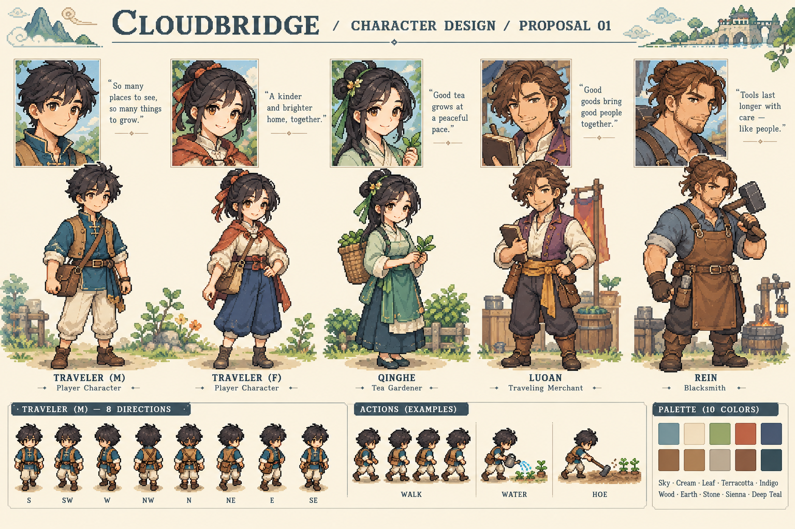
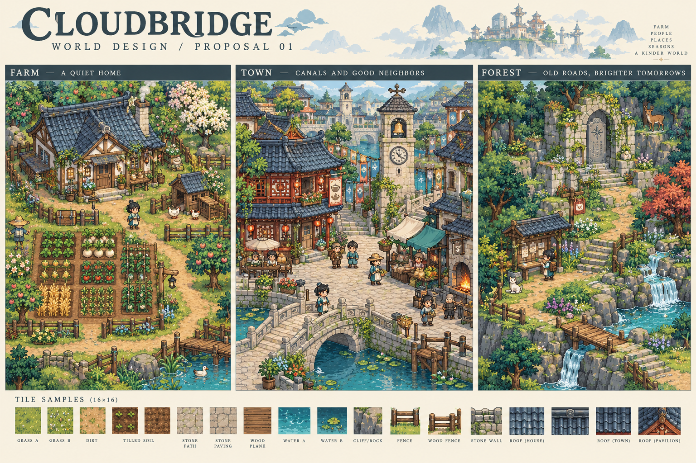
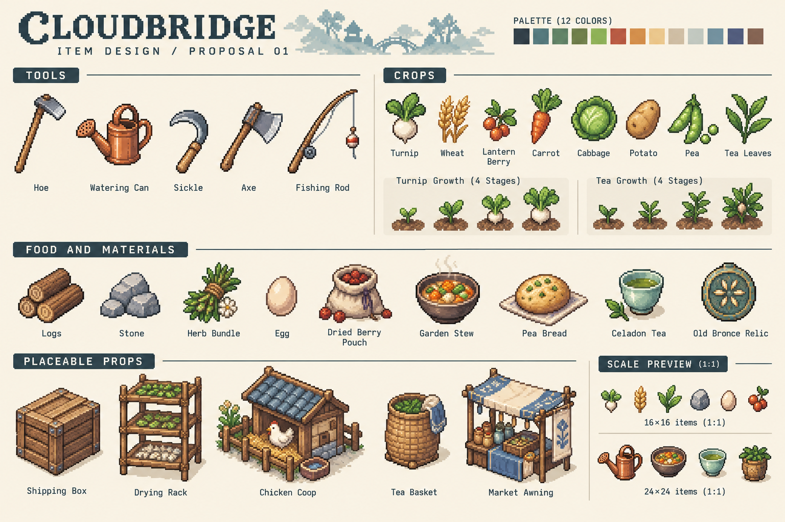

# 美術改版提案 01（待審核）

2026-10-21。以下為美術概念提案，尚未核准，尚未匯入遊戲。概念圖的像素尺寸、八方向與動作示意不是可直接使用的正式圖集；正式素材另行校準、逐格製作與驗收。

## 角色

男女旅人、青禾（茶農）、洛安（商人）、雷恩（鐵匠）重新設計。中式交領與腰帶搭配西式背心、披肩與工作圍裙；藍綠、米白、赭紅為共同配色。

## 場景

莊園、小鎮與森林古驛。唐宋灰瓦與木構融合中世紀石橋、鐘塔和市集。正式地圖須簡化概念圖的裝飾密度，保留清楚的通行空間、互動物件與手機畫面辨識度。

## 道具

五種工具、八種作物、料理素材、加工架與雞舍等。圖像風格與人物場景統一；正式圖示需在手機實際顯示尺寸下驗收。

## 手機試玩回饋與修改門檻

- 方向控制需放大：待確認外觀後設計較大的控制區。
- 人物偶爾自動前進：原因尚未查明；後續檢查觸控放開、拖出範圍、多指、尋路與切換背景時輸入是否殘留，不預先宣稱已修復。
- 所有角色與美術需重新設計；在用戶核准角色、場景、道具之前，不將提案匯入遊戲，不變更遊戲行為或建置替換 APK。
- 審核可分別記錄角色／場景／道具為通過或需修改；局部通過不等同三項全部通過。
