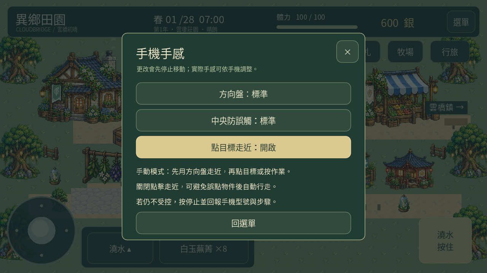
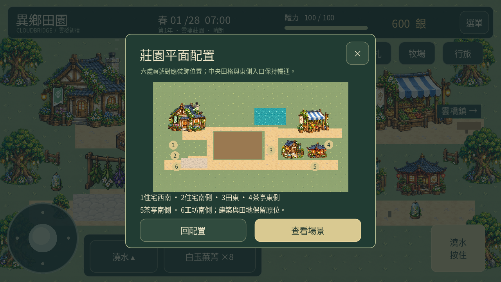
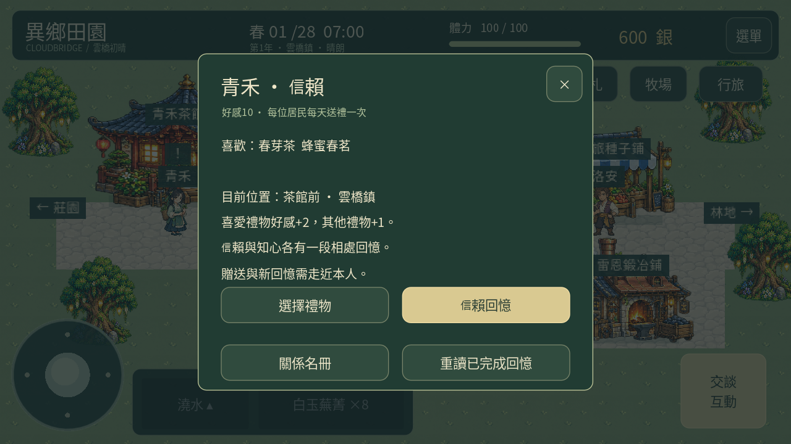
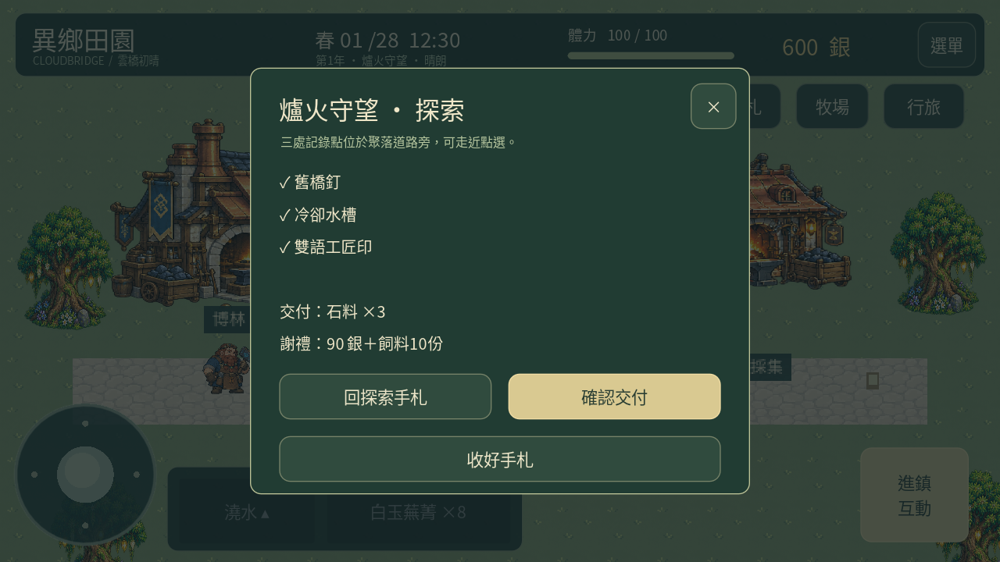
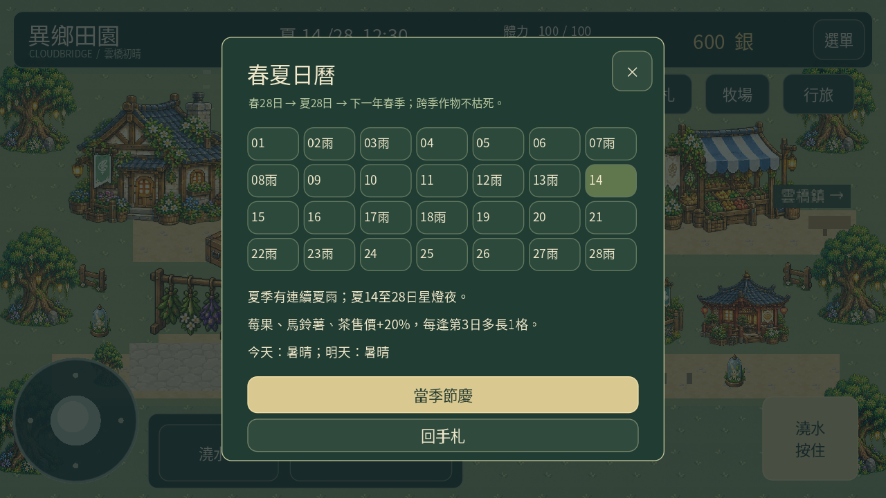
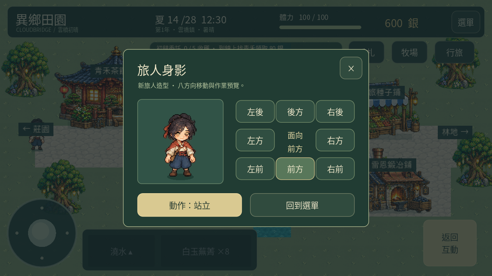
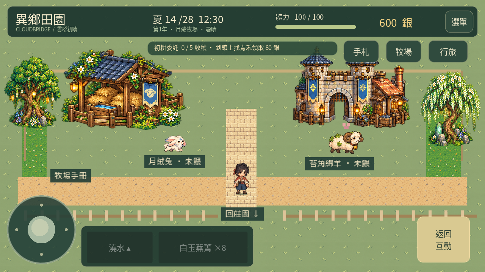

# 異鄉田園 0.24「春夏相知」

[下載 Android APK](https://github.com/SugarSaiyajin/ARISE/raw/refs/heads/delivery/android-0.24.0/arise-0.24.0.apk) · [觀看功能展示](https://github.com/SugarSaiyajin/ARISE/raw/refs/heads/delivery/android-0.24.0/gameplay.mp4)

Android 7.0+、ARM64、OpenGL ES 3.0。與0.23沿用同一簽章和套件，請覆蓋安裝保留進度，不要先解除安裝。更新前建議備份並另存完整備份碼。

## 本輪完成計劃1～7的可玩功能

1. 手機操作：方向盤可加大、中央防誤觸可調，另有關閉點擊尋路的手動移動模式。補強取消、背景、焦點、安全區改變及長幀移動保護，固定地面保留繪製。
2. 新手任務：澆水→休息→採收→出貨→播種，依成功操作記錄並顯示下一步。
3. 農場：三種路面、六處固定裝飾位、平面圖，保留田地與入口；不是自由搬房屋系統。
4. 動態：男女主角待機眨眼與伸展、居民腳步、動物餵食／跳動／休息；重用已通過美術。
5. 居民：九位角色的每日送禮、喜好、關係階段與各兩段相處回憶。
6. 經濟：工藝明示工費、水壺升級、保留兩份再出貨，附實際資料收益試算。
7. 內容：四聚落各三處線索及一次性交付委託、春夏輪替、夏雨、適合作物與夏夜星燈會。秋冬未加入。

第8項商店上架準備未進行。

入口：右上「手札」看生活功能；「選單→手機手感」調控制。「選單→存檔與試玩設定」備份。

[完整操作、規則及限制](GUIDE.md) · [4010項檢查報告](test-summary.json) · [APK驗證](validation.json) · [更新相容檢查](update-compatibility.json)

桌面／觸控版完整流程與12個音訊檔檢查通過；120遊戲日存檔重載、104次地圖切換無節點累積。仍需實機確認偶發失控、剪貼簿、軟鍵盤、持續遊玩耗電與發熱；以上不是手機效能驗收結果。

原始碼分支：feature/spring-summer-life-0.24，實作提交 b88717b。展示使用獨立測試進度，以下均為桌面Godot觸控版實際渲染。

