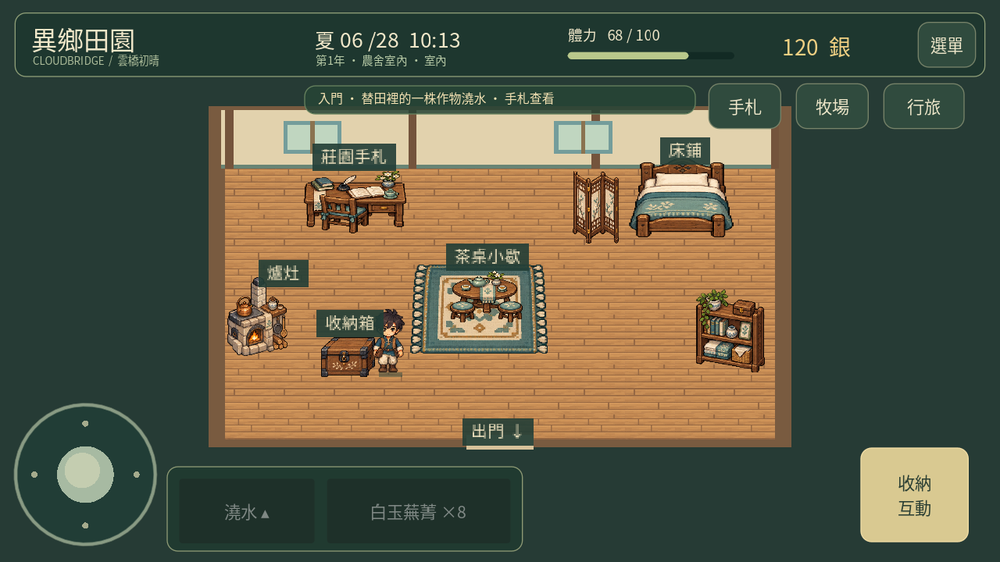
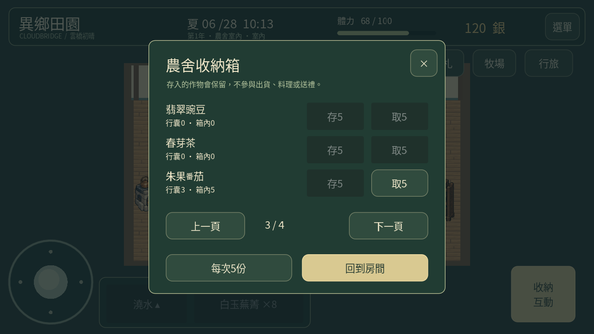
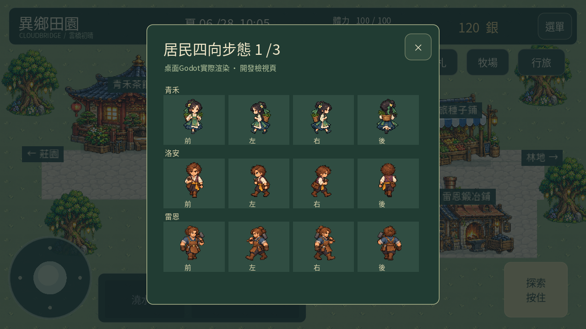
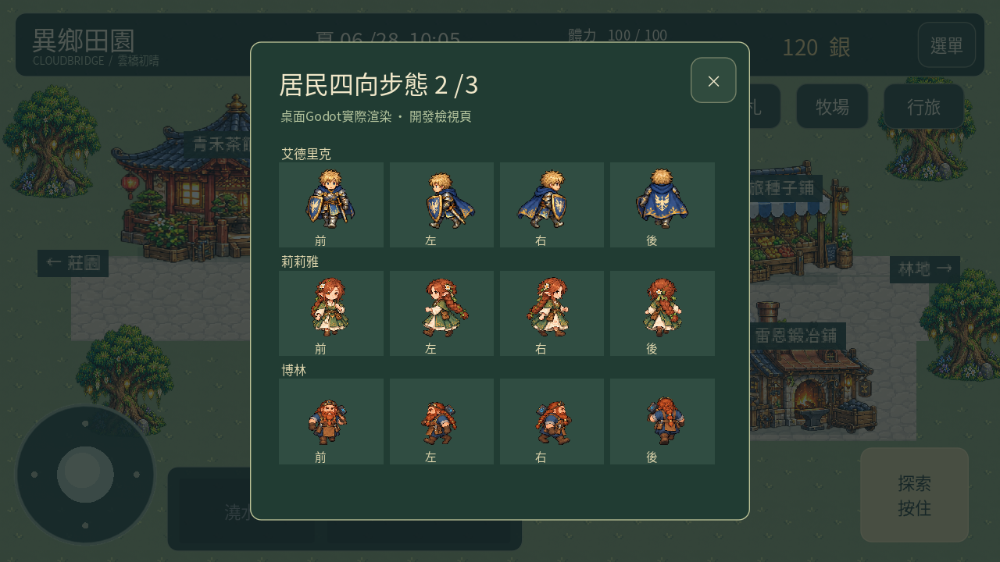
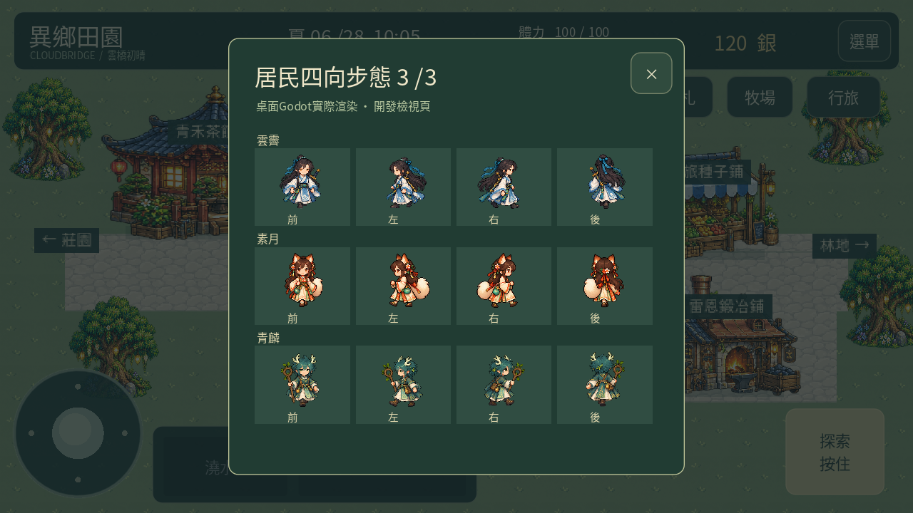

# 異鄉田園 0.27「雲橋日常」

[下載Android APK（約104 MB）](https://github.com/SugarSaiyajin/ARISE/raw/refs/heads/delivery/android-0.27.0/arise-0.27.0.apk)

Android7以上、ARM64、OpenGL ES3。與0.26同套件、同簽章，版本代碼升至27；請覆蓋安裝，勿先解除安裝，以免刪除存檔。檔案104,158,080 bytes，低於GitHub單檔100MiB上限。

本輪完成計劃1–7：九名居民四向步態與工作／採買／交流／歇腳日程，三道夏季料理、季節委託與作物喜好，八種養殖生物日常反應與待領提示，農舍收納、每日小歇與三種配色，以及道路色調整理與驗證。主角保留八方向，所有美術沿用已通過身份與素材風格。

[完整操作與限制](docs/LIVING_027.md) · [8,281項測試紀錄](docs/validation-0.27-tests.json) · [APK驗證](validation.json) · [更新相容性](docs/update-compatibility-0.27.json)

農舍木箱每次存取1／5份收成；箱內作物不會被出貨或當成料理食材。茶桌每日小歇20分鐘、回復最多8體力，重開不能重領。爐灶第10–12道食譜使用番茄、茄子與蓮藕。季節委託由鎮上公告牌接取。

[18.83秒實際Godot渲染影片](https://github.com/SugarSaiyajin/ARISE/raw/refs/heads/delivery/android-0.27.0/docs/living-0.27-gameplay.mp4)。使用獨立展示存檔、桌面Godot觸控介面；居民步態頁為開發檢視，不是玩家選單。畫面不能代表實體手機效能。

手機實測修正與上架準備仍暫緩。本輪沒有連接手機或模擬器。

APK SHA256：`4450365742f84f5fcd9d6076f60bdbd4466d6b6e1ce7ffc340b159e482f72f34`

[原始碼提交](https://github.com/SugarSaiyajin/ARISE/commit/83daeff)

公開APK、七張代表畫面與影片均已重新完整下載，HTTP200且SHA256一致。[下載校驗紀錄](docs/delivery-http-verification-0.27.json)。
