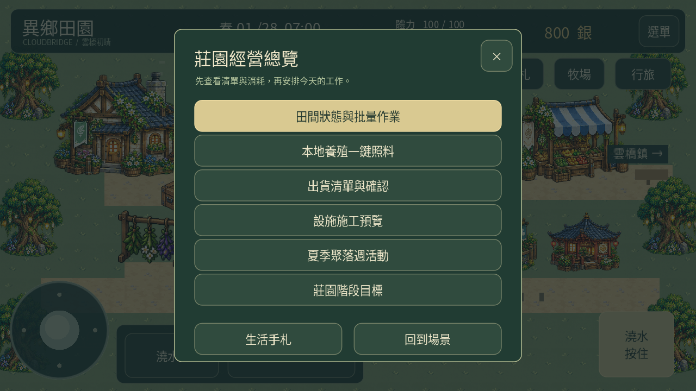
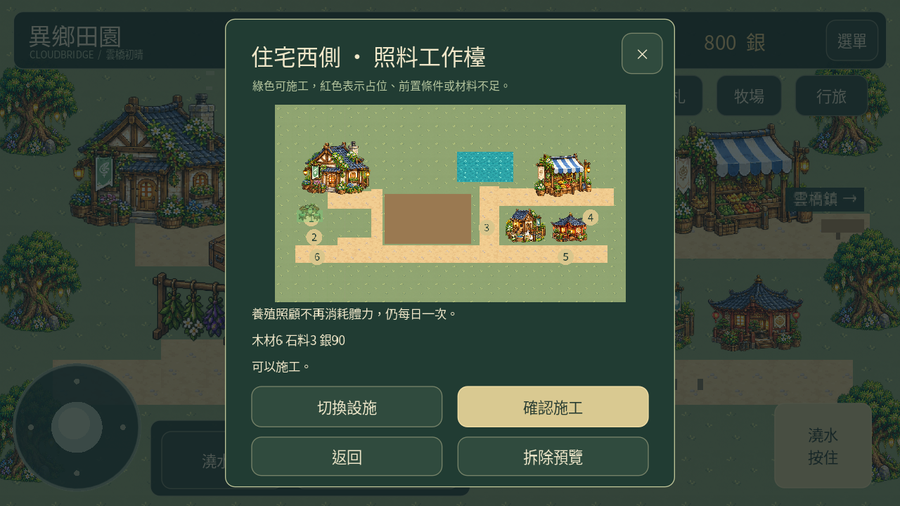
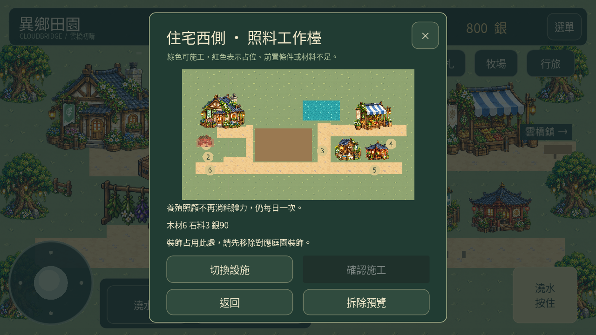
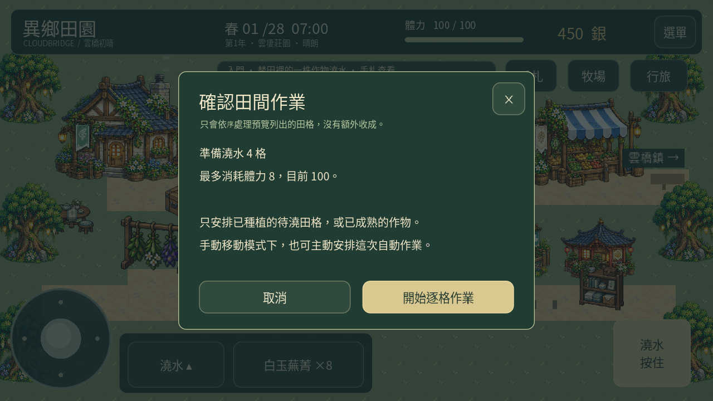
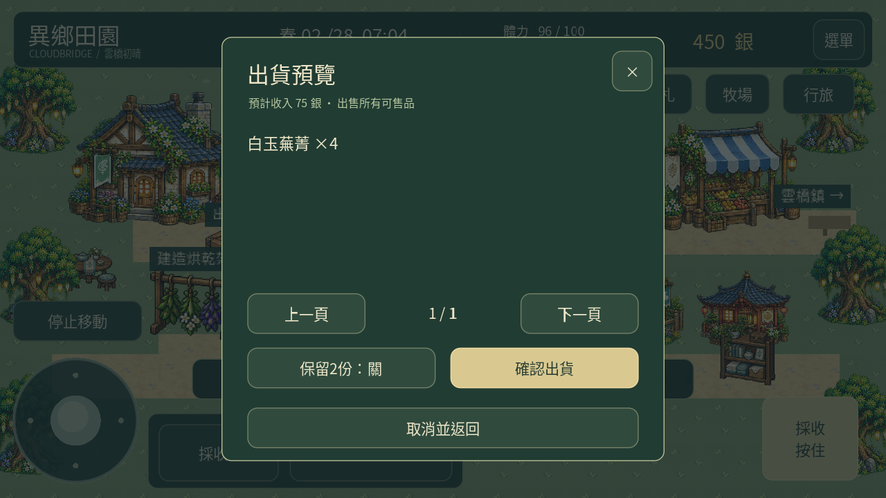
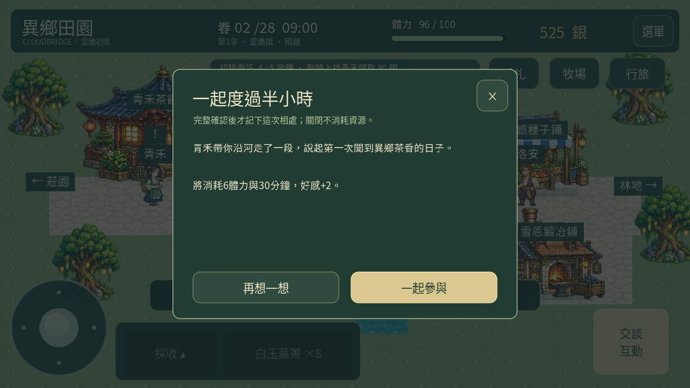
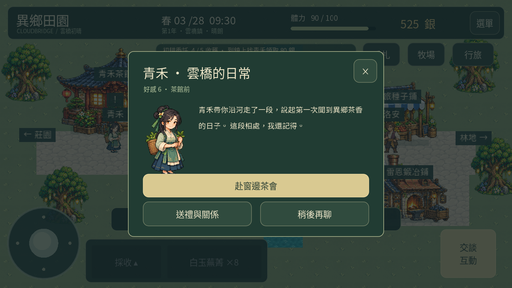
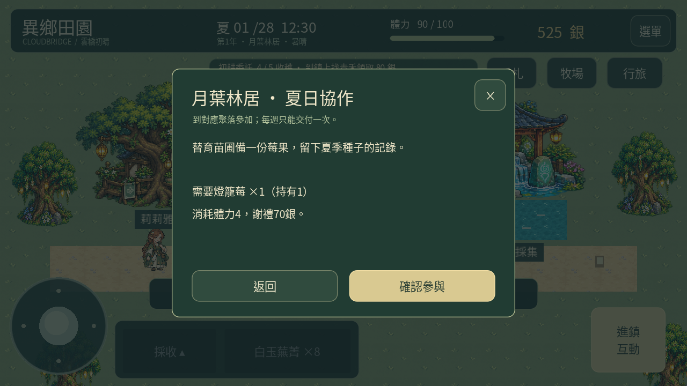
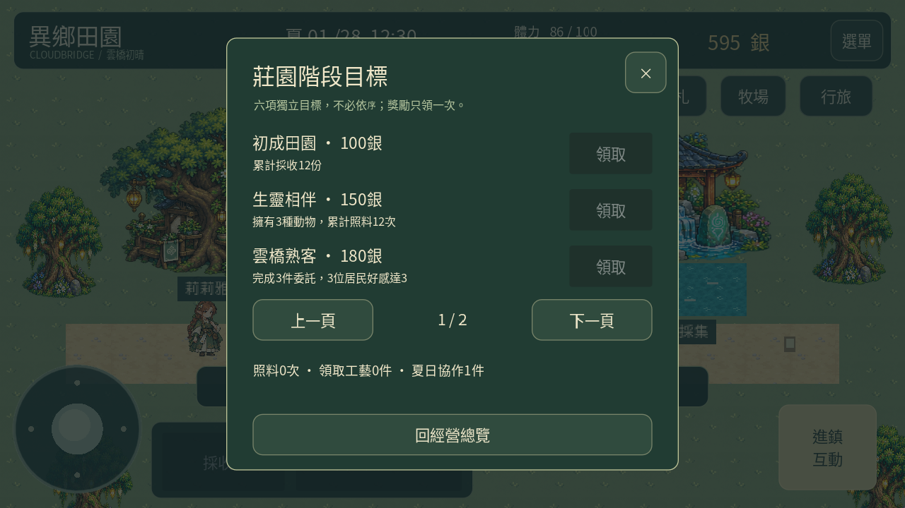

# 異鄉田園 0.25「田園共作」

[下載 Android APK](https://github.com/SugarSaiyajin/ARISE/raw/refs/heads/delivery/android-0.25.0/arise-0.25.0.apk) · [功能展示影片](https://github.com/SugarSaiyajin/ARISE/raw/refs/heads/delivery/android-0.25.0/gameplay.mp4) · [新美術提案04](design-review-04/README.md)

Android 7.0+、ARM64、OpenGL ES 3.0。與0.24同一套件／簽章，請覆蓋安裝保留進度；不要先解除安裝。

## 本輪玩法：繼續計劃2～7

- 田間狀態與批量澆水／採收：預覽後逐格走近操作，可中止，已完成成果保留。
- 本地養殖批量餵養、照顧、領取：先顯示資源清單，不足時整批保留。
- 出貨箱改成預覽清單＋確認；可每種留2份，設施加成已列入收入。
- 三處固定設施位置、半透明施工預覽、占位與素材檢查；水槽擴充、免體力照顧、出貨5%加成。
- 工具接觸圈、鋤地碎土、統一作物拾取回饋、領取養殖產物圖示。
- 九位居民分階段日常與每週共同活動；兩種選擇會留在後續對話。
- 四聚落夏季週協作、六項莊園階段目標，以及56天春夏經營資料驗證。

入口：右上手札 → 經營總覽。

手機實測修正依使用者要求暫緩，上架準備未開始。

## 待審新美術

提案04包含番茄、茄子、蓮藕，三種設施外觀，以及艾德里克／素月方向與步態示範。**尚未通過，沒有放進遊戲或APK**。完整新居民方向圖集與新夏季作物，要通過設計後再製作整合；現行功能沿用先前通過素材。

[查看提案說明](design-review-04/README.md)

## 驗證與操作

[完整規則與限制](GUIDE.md) · [6809項檢查報告](test-summary.json) · [春夏經營報告](campaign-balance-0.25.json) · [APK驗證](validation.json) · [更新相容檢查](update-compatibility.json)

6809項不重複檢查通過，另重跑桌面／觸控場景、完整遊戲流程與12個音訊檔。兩種56天策略沒有額外貨幣／素材，逐日存檔重載，現金收入與支出相符；此為資料層模擬，沒有模擬行走耗時，也不代表實機效能驗收。

原始碼分支 feature/estate-living-0.25，實作提交 87b7ca5。以下為獨立展示進度的Godot桌面觸控模式實際渲染。

