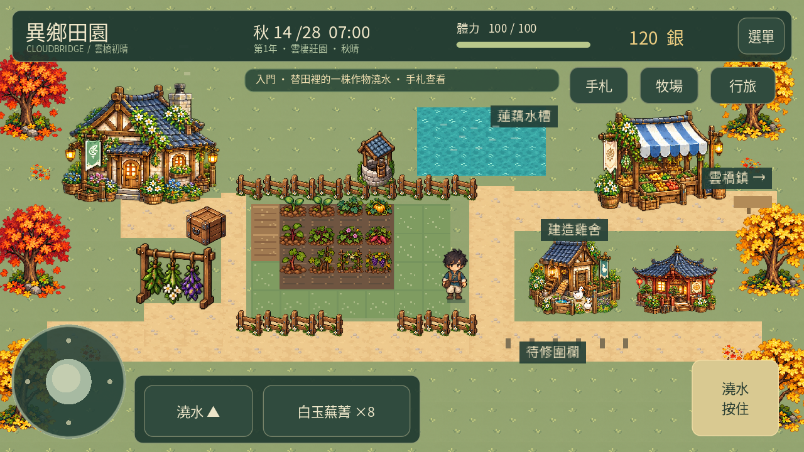
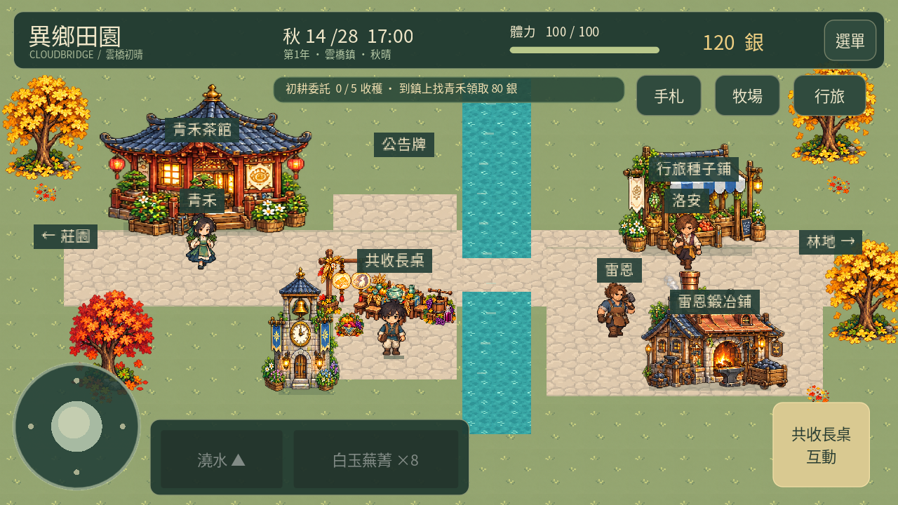
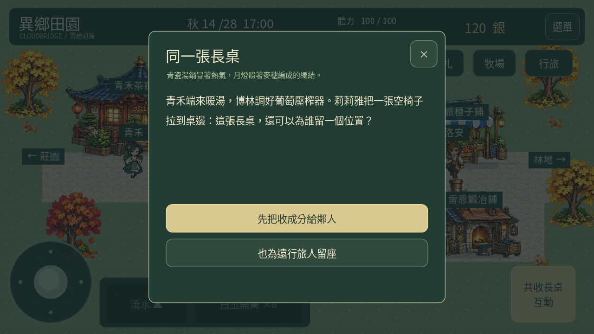
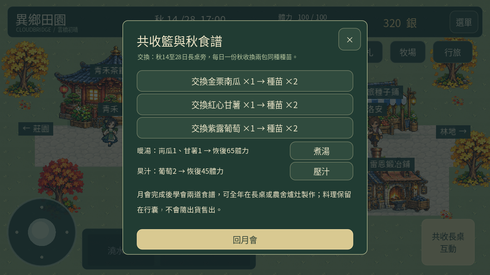

# 異鄉田園0.29「共收月會」

[下載Android APK（約104 MB）](https://github.com/SugarSaiyajin/ARISE/raw/refs/heads/delivery/android-0.29.0/arise-0.29.0.apk)

Android7以上、ARM64、OpenGL ES3。與0.28同套件與簽章、版本代碼升至29；請直接覆蓋安裝，勿先解除安裝，以免刪除存檔。可先在存檔管理匯出文字備份。

- 已通過的秋季正式作物：金栗南瓜、紅心甘薯、紫露葡萄；五階段圖集、商店、種植、收納與出貨均已整合。
- 金銀杏、局部紅葉與路旁落葉；月燈、收成籃、青瓷湯鍋、葡萄汁壓榨器及共收長桌。
- 秋14至28日共收月會：三種秋收各一份、兩種居民選擇、200銀謝禮、每日種苗交換與兩道食譜。
- 每季28日，春→夏→秋→次年春；舊存檔保留當季日期及年份，加工期限、週訂單、照料與送禮日數不重置。

入口：手札→季節日曆與節慶→當季節慶，或到雲橋鎮中央、鐘樓右側長桌互動。秋苗僅秋季購買／播種，跨季不枯死，葡萄單次收成。

[完整操作與數值](docs/AUTUMN_029.md) · [8,898項檢查](docs/validation-0.29-tests.json) · [APK驗證](validation.json) · [更新相容性](docs/update-compatibility-0.29.json)

[22.9秒實際Godot渲染影片](https://github.com/SugarSaiyajin/ARISE/raw/refs/heads/delivery/android-0.29.0/docs/autumn-0.29-gameplay.mp4)。桌面Godot使用觸控介面與獨立示範存檔；不代表實體手機效能，不會把示範資源加入玩家進度。

完整回歸與最終桌面／觸控秋季檢查通過；包含從起始資源完成84日的經營狀態模擬。APK有v2簽章與16KB頁面對齊，正式秋季資產已包含，概念板與開發檔已排除。未在實體手機或模擬器安裝。手機手感修正與上架準備維持暫緩。

[原始碼提交](https://github.com/SugarSaiyajin/ARISE/commit/228187f)

APK大小：104,388,633 bytes，低於GitHub單檔100MiB限制。

APK SHA256：`b1a2da6fecffe7450153e054c34fbdff385eb182ea042997821bd2d174a8cbe8`
