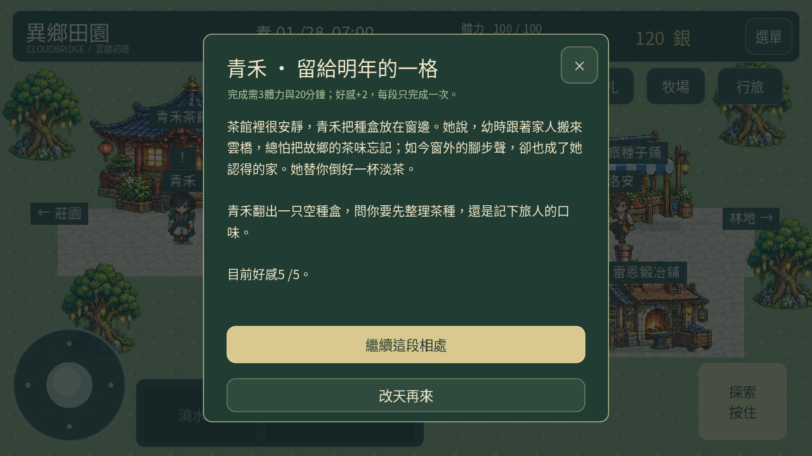
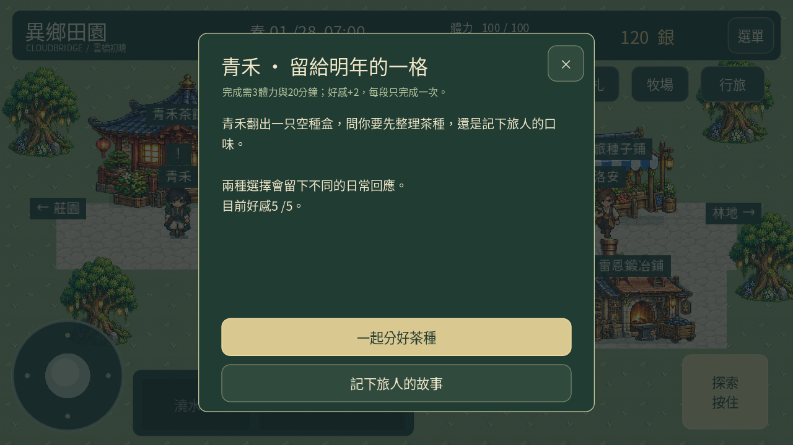
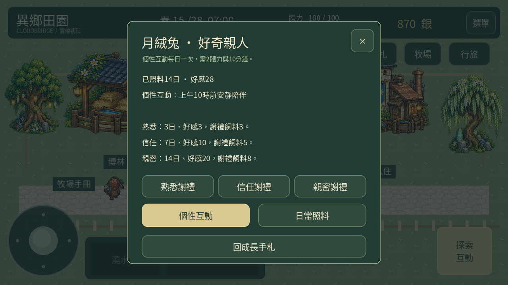
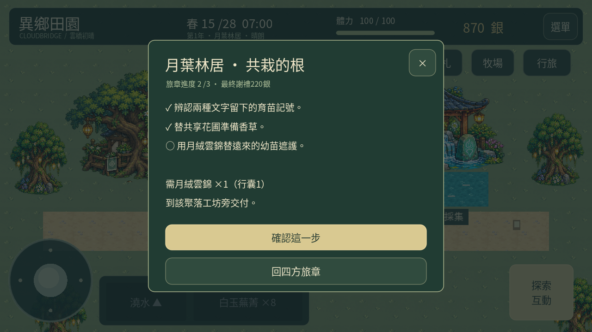
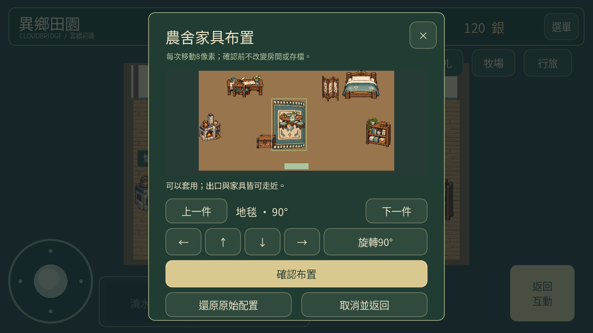
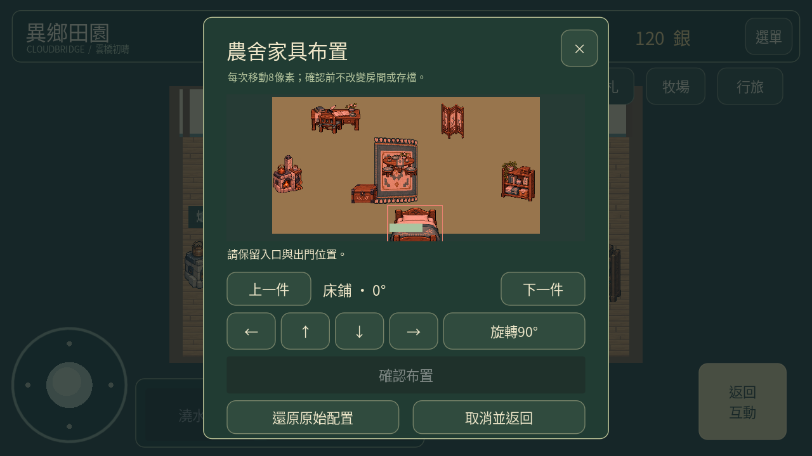
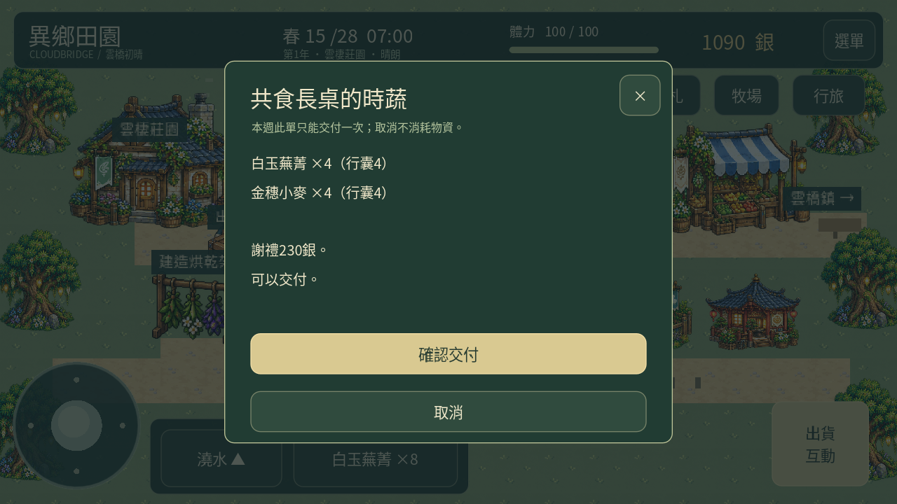

# 0.28「旅章與共生」

本輪完成計劃1–5的遊戲功能、計劃6的秋季設計審閱稿，以及計劃7的整合驗證與交付。秋季尚未通過審閱，沒有加入遊戲；手機手感修正與商店上架維持暫緩。

## 居民專屬生活事件

九名居民各一段新情境敘述、兩個選擇與不同的後續日常回應。從手札→經營總覽→長期發展→居民專屬生活事件進入；居民關係頁也提供入口。

好感達5、走近本人、備有3體力與20分鐘後，在最後選擇才結算。兩種選擇均增加2好感，分別留下不同的對話，不設較差答案。未完成前關閉不消耗，完成後可重讀，不能重複增加好感。原有信賴、知心與共同活動記錄保留。

## 養殖個性與成長

日常照料會自動記下實際照料日數；新手札提供八種生物的個性提示、時段互動與成長謝禮。舊存檔保留原好感，新增日數從0開始，沒有推算或贈送無法證實的歷史照料。

| 階段 | 累計照料 | 好感 | 一次性謝禮 |
| --- | ---: | ---: | ---: |
| 熟悉 | 3日 | 3 | 飼料3 |
| 信任 | 7日 | 10 | 飼料5 |
| 親密 | 14日 | 20 | 飼料8 |

個性互動每日一次，消耗2體力與10分鐘，增加1好感；時段或天氣不符合時不扣除。母雞的好感由實際陪伴日數及個性互動累計，新增整理羽毛操作每日一次、耗1體力。其他生物沿用原有照料與餵養。達信任階段後，會在稍遠處回應靠近的玩家；不會自行產生物資。

- 母雞、兔子、靈鹿偏好上午10時前。
- 鴨子偏好14–17時；綿羊偏好14–18時。
- 蜂群偏好晴天10–16時；蠶群偏好雨天或17時後。
- 星鱗鯉偏好17–19時。

階段按種類記錄；現有同類母雞共用陪伴記錄，沒有宣稱每隻母雞都有獨立隨機性格。好感已滿時，個性互動不再扣除資源。

## 四聚落探索旅章

每個聚落有觀察、原料交付、工藝品交付三步，連結原有採集、養殖與加工。先到該聚落的第一處記錄點，再到工坊旁交付。必須使用行囊實物，箱內物品不會被默默扣除。

| 旅章 | 原料 | 工藝品 | 完成謝禮 |
| --- | --- | --- | ---: |
| 月葉林居 · 共栽的根 | 香草2 | 月絨雲錦1 | 220銀 |
| 爐火守望 · 冷卻的次序 | 石料3 | 苔絨暖毯1 | 300銀 |
| 雲泉靈修院 · 水聲記人 | 香草2 | 青玉護符1 | 360銀 |
| 星落市集 · 兩地的秤 | 木材3 | 星露靈燈1 | 430銀 |

每步進度保存，最終謝禮只領一次。這是既有地圖內的短篇探索與交付，沒有新增未審地圖或戰鬥系統。

## 家具擺放與旋轉預覽

八件既有家具都能以8像素步距移動、90度旋轉、切換選取、還原原始配置。預覽保持獨立，按下確認才改變房間與存檔；可在其他地圖查看，但只能在農舍確認。

家具超出房間、實體占位重疊、出口或互動通道受阻時拒絕套用。地毯可放在家具下。若新位置蓋住主角或把主角困住，也不會套用或強制傳送。套用時更新碰撞、導航、互動點及標示，木箱存取與茶桌小歇會跟隨家具新位置。

本輪旋轉使用既有圖像的平面旋轉，沒有新增四套不同透視的家具美術。沿用已通過素材；後續若製作新的家具方向造型會先送審。

## 每週訂單與長期目標

每週三份合作訂單，從第1日起每7日換週，走近莊園出貨箱確認交付。沒有預先扣料，取消或換週保留未交付物資；預覽若過期或庫存改變，必須重新查看。

| 訂單 | 需要 | 謝禮 |
| --- | --- | ---: |
| 春季時蔬 | 蕪菁4、小麥4 | 230銀 |
| 夏季時蔬 | 番茄2、茄子1 | 270銀 |
| 單數週加工補給 | 乾燥麥穗3 | 165銀 |
| 雙數週加工補給 | 莓果乾2 | 180銀 |
| 棲地日常交換 | 鴨蛋2、月絨1 | 145銀 |

每週實際顯示一份當季時蔬、一份當週加工補給、一份棲地交換，各只能完成一次。相對直接出貨的基本價約增加15%–25%；原有保鮮貨架加成不套用於訂單，避免重複加成。

長期目標為完成3段居民生活事件、4個聚落旅章、累計6份週訂單、3種生物達親密，各一次性謝禮100／200／250／200銀。不必依序完成。

## 存檔、字型與驗證

新增可省略的`chapter`、`growth`、`interior`欄位，舊存檔使用空進度、零照料日數與原始家具配置。JSON位置讀回會正規化為整數；備份、重啟與匯出碼沿用原子存檔及驗證機制。原有作物、金錢、關係、家具收納、主線與日期保留。

新測試覆蓋18種事件選擇及日常回應、4個旅章的每步消耗、春夏及跨週訂單、防重領、14日實際餵養照料成長、里程碑、家具移動與旋轉、阻擋與導航、動態木箱互動、舊存檔、重啟及手機版面。加入段落與按鈕不重疊檢查，並補齊內建字型；測試檢查所有正式腳本與地圖文字皆有內建字形。開發測試工具依賴見`requirements-dev.txt`。

[完整測試紀錄](validation-0.28-tests.json) · [15.7秒實際Godot渲染影片](chapter-0.28-gameplay.mp4)。展示使用獨立示範存檔，包含預備物資、好感與14日照料樣本；不是新遊戲贈送。畫面在桌面Godot渲染觸控介面，不能代替實體手機安裝、手感、FPS或電量測試。

## 秋季獨立審閱稿

[提案05：秋季、三種作物與共收月會](design-review-05/README.md)。僅為待審概念稿，未放入APK。遊戲仍維持原春夏循環，不會提前改動既有存檔日期。
