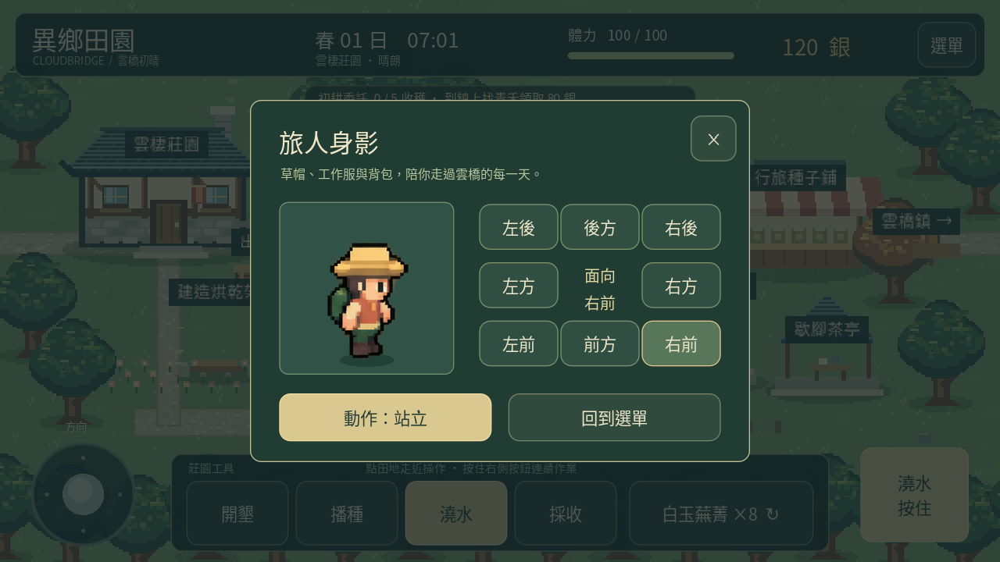
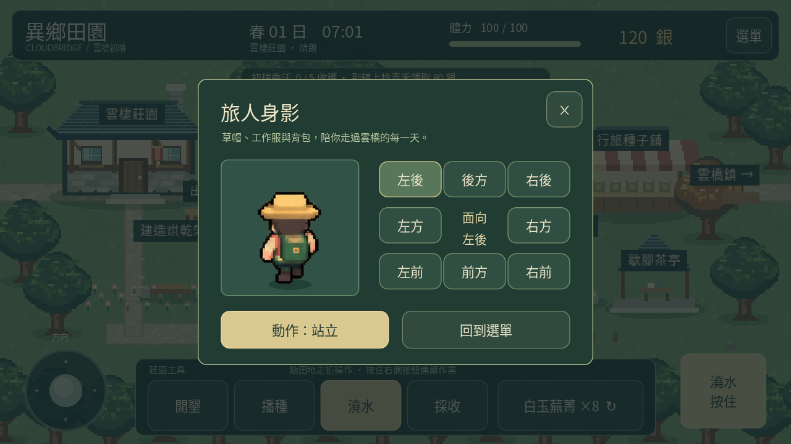

# 0.14 旅人身影

## 查看角色

選單 →「角色外觀」可近距離查看目前的旅人造型。右側八個方向按鈕切換正面、背面、左右及四個斜方向；左下「動作」按鈕依序切換站立、步行、作業姿勢。

預覽沿用遊戲實際的角色圖與腳底支點，放大顯示。首次開啟會選中角色當前顯示的面向；預覽內切換方向不改變遊戲中的面向或位置。查看期間暫停遊戲日鐘，不扣體力、食材或銀幣，也不發收成。作業預覽展示人物姿勢，不會操作田地。

「回到選單」返回手札；右上關閉或 Android 返回鍵回到遊戲。切到背景或失去焦點時預覽動畫暫停，所有暫停原因解除才恢復；站立預覽與背景暫停時避免持續要求重繪。

## 方向交界穩定

八方向仍以 45 度為基本區間。連續移動時，顯示面向在原區間外多保留 5 度緩衝，減少手指靠近交界時角色在兩個圖像間來回閃動。

例如從右方轉向右前：一般交界在 22.5 度，本版超過約 27.5 度才換成右前；回轉時需小於約 17.5 度才換回右方。這是角度緩衝，明確轉向或反向時立即更新，沒有額外等待時間。

只有顯示面向使用緩衝；角色移動方向、速度、碰撞及互動目標計算都沿用真實輸入角度。工具動作開始時，立即顯示朝向作業目標的姿勢，不受交界緩衝影響。停止後保留穩定的最後顯示面向。

## 存檔與驗證

版本 1 存檔沒有新增欄位。預覽選項與方向緩衝均為暫時狀態，關閉預覽不改動玩家進度；既有資料可繼續使用。

新增 113 項檢查，包含八方向雙側交界與回轉、快速反向、工具立即轉向、輸入角度不被量化、八個觸控方向按鈕、三種動作、背景與焦點的雙重暫停、返回及無遊戲資料變動。桌面與手機介面各執行一次。

[觀看實際引擎示範](character-0.14.mp4)。只安排起始位置，使用實際搖桿拖動與預覽按鈕，展示交界穩定、明確轉向、八個面向、動作切換、暫停及返回遊戲。

Android 模擬器與實體手機安裝、搖桿實際手感、背景恢復與效能仍待確認。
