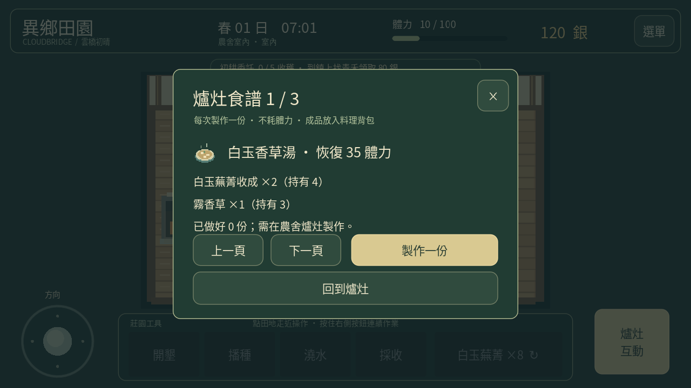
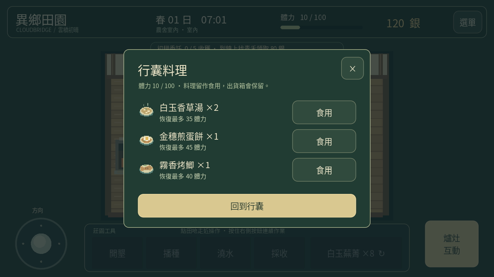

# 0.11 爐邊好食

回農舍點左側「爐灶」，可煮原有草茶、查看料理食譜，或打開料理背包。食譜一開始就可用，不需另建廚房。

| 料理 | 每份食材 | 恢復體力 |
|---|---|---|
| 白玉香草湯 | 白玉蕪菁收成 2、霧香草 1 | 35 |
| 金穗煎蛋餅 | 金穗小麥收成 1、已領取雞蛋 1 | 45 |
| 霧香烤鯽 | 銀鱗鯽 1、霧香草 1 | 40 |

食譜可左右換頁，每次製作一份，立即放入料理背包。不耗銀幣或體力，也不需等到隔天；零體力仍可在農舍料理。製作前會先確認所有材料及背包空間，不足時完全不扣料。種子、巢箱未領取的蛋、其他魚種都不會代替指定食材。

選單 → 背包與收成 → 料理，可在任一地圖食用。每次吃一份，體力最多回復至 100，接近滿體力時仍會用掉整份料理；已滿時不消耗。料理沒有腐壞或每日食用上限。睡眠、過圖與出貨都會保留料理，出貨箱僅出售原有作物、加工成品、雞蛋及魚獲。

料理視窗沿用暫停規則，遊戲日鐘不流逝。查看、換頁、關閉或切到背景不會自動製作；製作與食用成功後立即存檔。存檔維持版本 1，新增可選 meals 欄位；舊存檔預設三種料理均為零，保留其他進度。載入時檢查完整的三種庫存，拒絕負值、小數、未知料理及不合理數量。

原有草茶仍消耗霧香草 1、恢復最多 20 體力，製作後直接飲用；滿體力不消耗香草。料理可存放並帶去林地使用，兩種用途並存。

目前只有這三張固定食譜，尚未加入料理品質、料理出售、居民贈禮或食譜解鎖事件。

[觀看實際引擎示範](cooking-0.11.mp4)。起始收成、已領雞蛋、銀鱗鯽、香草、低體力及農舍內的位置經安排，沒有預先放入成品料理。走近爐灶、三種製作、走回莊園後觸控食用、滿體力保護及出貨保留料理均使用正式流程。

Android 模擬器及實體手機安裝、觸控手感、背景恢復、效能與音訊延遲尚待驗證。
