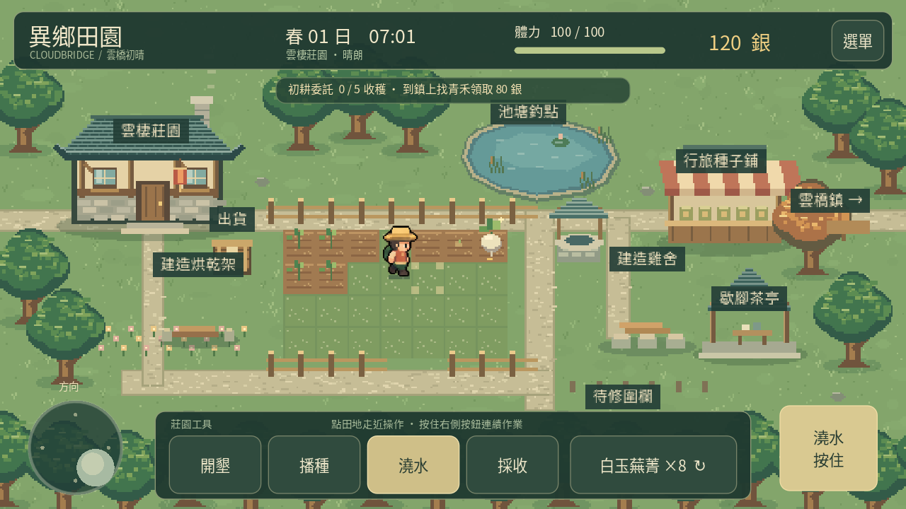
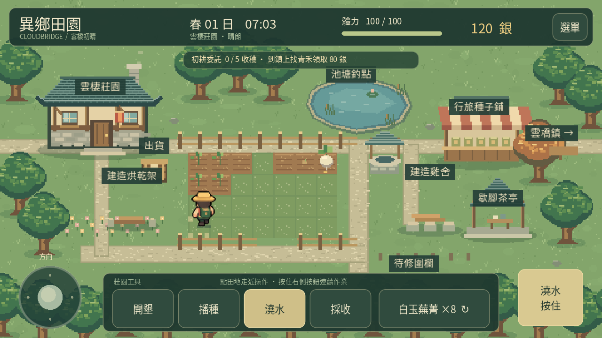

# 0.13 八方行旅

主角使用八個方向的獨立圖像：前、後、左、右，以及左前、右前、左後、右後。每個方向有站立、三格步行與四格工具姿勢，共 64 格。

## 移動與操作

- 鍵盤同時按兩個方向鍵、斜推搖桿，以及點擊尋路，都會依實際面向選擇圖格。
- 基本方向區間為 45 度；0.14 在顯示面向交界加入 5 度緩衝，停止時保留穩定面向，回到該方向的站立姿勢。詳見 [旅人身影](CHARACTER_PREVIEW.md)。
- 斜向與直向的最大速度相同；搖桿推到一半時各方向也維持相同的半速，不會因斜走多加速度。
- 碰撞及尋路沿用現有規則，圖片轉向不改變角色可通行的範圍。
- 田間操作依目標方向顯示對應工具姿勢，仍在約 0.30 秒作業期間固定位置與面向，結算一次。詳見 [工具操作](TOOL_ACTIONS.md)。

目前主角是可移動角色。青禾、洛安與雷恩仍使用原有四方向圖集與固定站位，人物靠近時的轉頭使用各自圖集的有效方向，不會讀到不存在的圖格。

## 美術與圖集

hero_eight.png 以原有草帽、暖色工作服、綠色背包的主角為參考，使用圖像生成製作，保留輸出的透明 PNG。四個斜方向各有不同的正側面或背側面造型。

來源圖為 1254×1254，不是嚴格等距的引擎圖集。未將它直接當作等分網格使用，而是由 tools/register_hero_frames.py 讀取人物區域，將 64 個來源範圍與腳底支點寫入 scripts/hero_frames.gd。圖片本身沒有被腳本裁切或修改。遊戲依範圍取圖、使用共同比例及腳底支點繪製，避免角色因圖格留白不同而跳位。

重新登錄來源範圍：

    python3 tools/register_hero_frames.py assets/pixel/hero_eight.png

腳本只需 Pillow，不修改輸入 PNG。改換人物圖時需重新登錄並檢查腳底與手部位置。原有 hero.png 保留作原型參考；tools/create_pixel_assets.py 不會重建新的生成圖。

## 相容與驗證

存檔仍為版本 1，沒有新欄位；位置、農田與全部既有進度保留。與先前版本一樣，重新開啟預設朝向，面向本身不寫進存檔。

新增 114 項檢查，涵蓋八方向及每區間邊界、搖桿幅度、停止面向、來源圖範圍與支點、64 個非空姿勢、原居民圖集、實際鍵盤斜走、斜向工具鎖定及碰撞；桌面與手機介面各執行一次。既有農耕、居民、養雞、探索、釣魚、料理與工具操作也持續驗證。

[觀看八方向實際示範](directions-0.13.mp4)。影片展示八方向行走與停止，以及四個斜方向的工具姿勢。起步位置、四塊展示田的狀態及工具展示時的位置經安排；輸入、方向選擇、移動、扣資源及動作鎖定使用正式流程。

Android 模擬器與實體手機安裝、更新、觸控手感及效能尚待確認。
