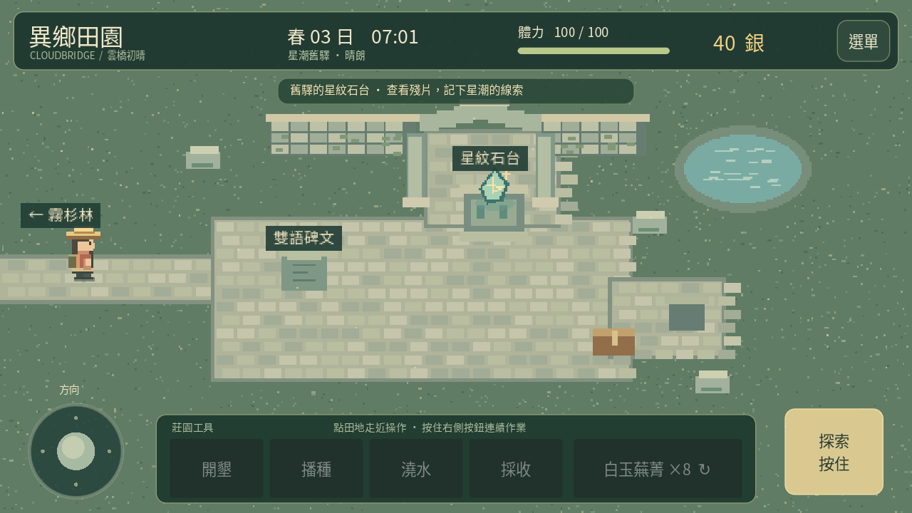
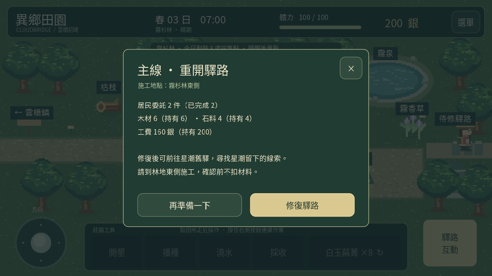

# 0.9「星潮舊驛」

完成兩件居民委託，讓小鎮的人認識你。準備木材 6、石料 4、160 銀，前往霧杉林東側「待修驛路」，確認修復。需求不足、地點不符或已經修好時不扣資源。

農舍書桌的「莊園手札 → 驛路主線」可預覽需求與進度，實際施工在林地進行。驛路修好後永久通行，點路牌或沿東路步行可進入星潮舊驛；從遺跡西側回林地，原有地圖可正常往返。沒有新增的現實時間等待。

舊驛有兩處主要互動：

| 位置 | 內容 |
|---|---|
| 左側雙語碑文 | 東洲符印、西陸晶石術與星潮的線索，可反覆閱讀 |
| 中央星紋石台 | 兩幕發現事件，確認最後一幕才收藏殘片並領獎 |

發現獎勵為白玉蕪菁、金穗小麥、燈籠莓種子各 3 包，以及 120 銀。星紋殘片是手札收藏紀錄，不能出售或消耗；不新增行囊堆疊。收好後，石台上的發光殘片消失，主線與手札顯示已收藏。

中途關閉事件不領獎，可重新查看。完成後回看只顯示線索，不重複給種子或銀幣；種子空間不足時也不會部分領取。遺跡的發現不增加作物採收、居民委託數或出貨收入。

夜間在遺跡逗留也會照常回農舍睡眠，田地、加工與養雞隔日規則一起運作。遺跡水池、石柱與石台有碰撞；進出會清除舊尋路與觸控狀態。這版提供探索與敘事，尚未加入戰鬥、陷阱或更多遺跡機關。

存檔維持版本 1，新增可選 route_restored、relic_recovered，area 增加 ruins。0.8 及更舊資料缺少時預設未修復與未發現，其他進度保留。已在遺跡的位置和修復／收藏旗標一起保存；無開路旗標卻在遺跡的矛盾資料會拒絕讀取，沿用備份復原流程。

[觀看實際引擎示範](exploration-0.9.mp4)。影片安排既有委託紀錄與修復物資，其餘修路、探索、收藏及步行返回莊園使用正式流程。尚未在手機實際安裝與驗證效能。
