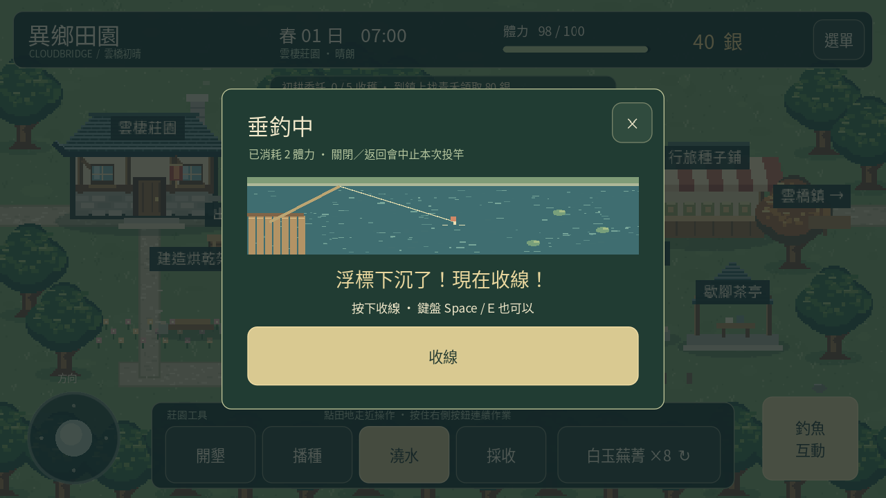

# 0.10 霧泉垂釣

製作一支永久魚竿，讓農耕之外多一項每日活動。點釣點水面或標籤，角色會走近並開啟互動。

## 製作與釣點

第一次在任一釣點支付木材 4、石料 2、80 銀；不足不扣除，製作後全釣點共用。

| 地圖與釣點 | 魚種 | 每尾售價 | 咬鉤後收線時間 |
|---|---|---|---|
| 雲棲莊園池塘 | 銀鱗鯽 | 32 銀 | 1.6 秒 |
| 霧杉林霧泉 | 霧泉鱒 | 48 銀 | 1.4 秒 |
| 星潮舊驛星泉 | 星紋鱸 | 72 銀 | 1.2 秒 |

星泉需要先完成兩件居民委託並修復驛路，見 [驛路主線](EXPLORATION.md)。各地固定魚種，目前沒有隨機品質或稀有度。

## 投竿與收線

1. 點「投竿」立刻消耗 2 體力，開啟浮標畫面。
2. 等待約 1.8 秒，看到「浮標下沉了！現在收線！」後按下「收線」。桌面也可用空白鍵或 E。
3. 在期限內按下即獲一尾；太早或逾時沒有魚。手機按下收線便判定，不必等放開。

每日三處合計最多釣到三尾，失敗不占尾數，但仍消耗體力。額滿、體力不足或魚獲庫存達上限時不能投竿，也不扣體力。睡眠後當日尾數歸零，魚竿和魚獲保留。

開啟釣魚視窗時遊戲日鐘暫停，浮標倒數持續。關閉、返回、切到背景或失去焦點會中止這一竿，不發魚、不退還體力。回前景停在暫停選單；不會恢復已中止的倒數。

## 背包、出貨與存檔

選單 → 背包與收成 → 魚獲，可看三種庫存與當日尾數。莊園出貨箱會把魚與作物、成品、已領雞蛋一起出售，保留魚竿、林地素材及未領取物品。

製竿、投竿與結果均保存。投竿立刻保存已消耗體力，但不保存進行中的倒數；中途強制關閉後重開，不補發魚。版本 1 存檔新增可選 fishing_rod、fish、fish_caught_today；舊檔預設沒有魚竿與魚獲、當日零尾，既有進度保留。

0.11 已加入銀鱗鯽的香草烤魚，見 [料理玩法](COOKING.md)。尚未加入魚餌、圖鑑收集獎勵或魚竿升級。

[觀看實際引擎示範](fishing-0.10.mp4)。僅安排起始製竿材料及靠近池塘的位置；等待咬鉤使用真實畫格，交易、觸控收線、失敗、中止及出貨均走正式流程。三地釣魚與跨日另由桌面、手機介面自動化場景驗證。

尚未於 Android 模擬器或實體手機安裝執行，實際觸控、背景恢復、效能及音訊延遲仍待確認。
