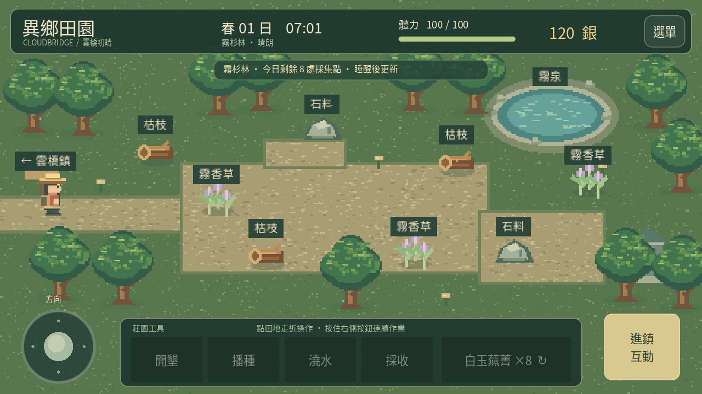
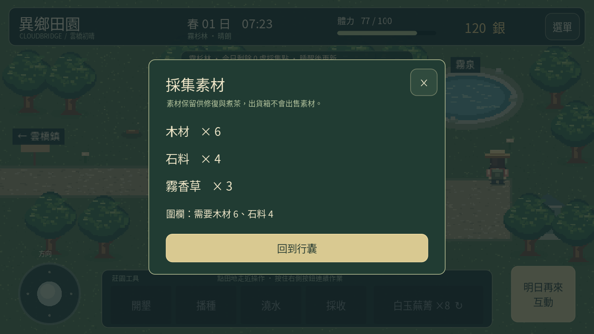

# 0.5「林間拾光」

從雲棲莊園沿東路進雲橋鎮，再從鎮東路前往霧杉林。點素材會自動走近採集，也能用搖桿走近後按右側「採集」；不必切換農具。林地沒有戰鬥或斧鎬升級。

| 素材 | 每日採集點 | 每處產量 | 每處體力 | 用途 |
|---|---:|---:|---:|---|
| 木材（枯枝） | 3 | 2 | 3 | 莊園圍欄 |
| 石料 | 2 | 2 | 4 | 莊園圍欄 |
| 霧香草 | 3 | 1 | 2 | 農舍爐邊煮茶 |

每日全部採完可獲得木材 6、石料 4、霧香草 3，消耗 23 體力。素材在「選單 → 背包與收成 → 採集素材與修復」查看。出貨箱只出售作物，會保留素材。

採完後圖像會變成殘枝、碎石或嫩芽，並保留當天的採集紀錄。離開林地、重開遊戲、讀取存檔都不會更新採集點。睡一晚後八處全部更新，背包素材保留；晚上 22:00 也會自動回農舍休息。

回到莊園，點南側「待修圍欄」，備齊木材 6、石料 4 後確認修復。這是一次性的外觀修復，木樁與石基會變完整；沒有增加田地或產量。材料不足或已完成時不會再扣資源。修復狀態會存檔。

在農舍點左側爐邊，可消耗一份霧香草煮一杯茶，恢復最多 20 體力，上限 100。滿體力時不會消耗香草；採集需要的體力不足時也不會扣材料或領取資源。

存檔維持 version 1，新增可選 materials、gathered 與 fence_repaired。0.4 及更舊存檔缺少這些欄位時預設空素材、當天未採集與圍欄待修，原有農田、庫存、金錢、好感及區域位置保留。新增資源不是作物收穫，不計入青禾的五份採收委託。

[觀看實際引擎示範](foraging-0.5.mp4)。影片安排部分起步位置以縮短返程，採集與修復皆使用正式流程。桌面渲染、測試通過與 APK 結構驗證不代表已在手機安裝試玩。
