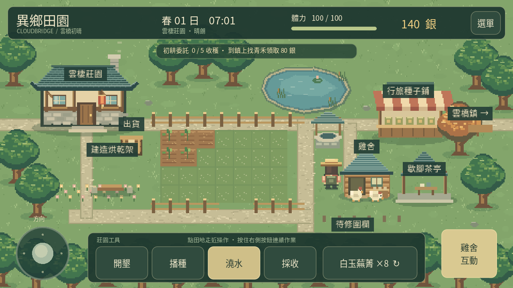
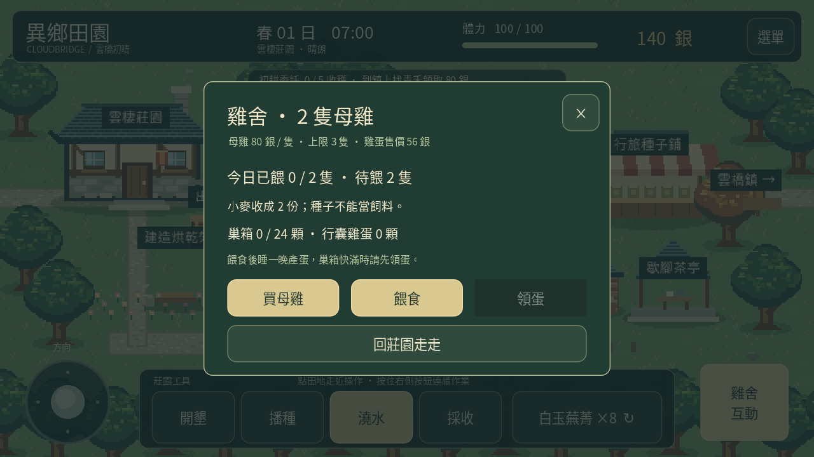

# 0.8「晨間咕咕」

在莊園水井南側點「建造雞舍」，備齊木材 8、石料 6、100 銀後確認建造。這筆費用只建雞舍，不包含母雞；母雞每隻 80 銀，最多三隻。建材或金錢不足不會扣除任何資源。

| 項目 | 規則 |
|---|---|
| 飼料 | 每隻每天一份小麥收成；小麥種子不能餵食 |
| 餵食 | 按「餵食」照料當天尚未吃過的母雞，不額外耗體力 |
| 產蛋 | 餵過的母雞在翌日各產一顆；未餵食只暫停，不會死亡 |
| 巢箱 | 最多 24 顆，不過期；餵食前會檢查隔日預留空間 |
| 領蛋 | 到雞舍按「領蛋」，全部移入行囊；不能重複領取 |
| 出貨 | 每顆 56 銀；出貨箱與作物、加工品一起出售 |

例如兩隻母雞都未餵食時，要準備兩份小麥。先餵了一隻再買第二隻，系統只再扣新雞需要的一份；未餵的新雞不會免費產蛋。飼料不足不會部分扣除，也不會消耗種子。

小麥需要三個澆水日成熟，雞舍沒有直接購買飼料的功能。準備收成後再擴養，可避免一時沒有飼料。未餵食期間母雞仍保留，不扣銀幣、好感，也不會減少已有雞蛋。

巢箱與行囊分開存放。出貨箱只賣已領取的蛋，不會出售巢箱中的蛋、母雞或林地素材。巢箱快滿時請先領蛋，系統會在餵食前預留明日產量，避免扣了飼料卻放不下蛋。行囊雞蛋已滿時拒絕領取，巢箱仍保留。

存檔沿用版本 1，新增可選 coop_built、chickens、fed_chickens、nest_eggs、eggs。0.7 及更舊資料缺少欄位時預設未建、無母雞與雞蛋；農田、加工、素材、圍欄、委託、茶會與好感保留。當日已餵數量與巢箱都會存檔，重新載入不加速產蛋，也不重置餵食。

目前是雞舍外的管理視窗與母雞像素動態，沒有雞舍室內、孵化、動物命名、出售母雞或飼養好感。雞蛋暫不加入加工配方與居民委託。

[觀看實際引擎示範](livestock-0.8.mp4)。示範安排起始建材、銀幣與小麥收成，其餘建造、買雞、餵食、睡眠、領蛋及出貨使用正式流程。完整種小麥到餵雞的流程由桌面與手機介面場景測試驗證，尚未代表手機實機測試。
