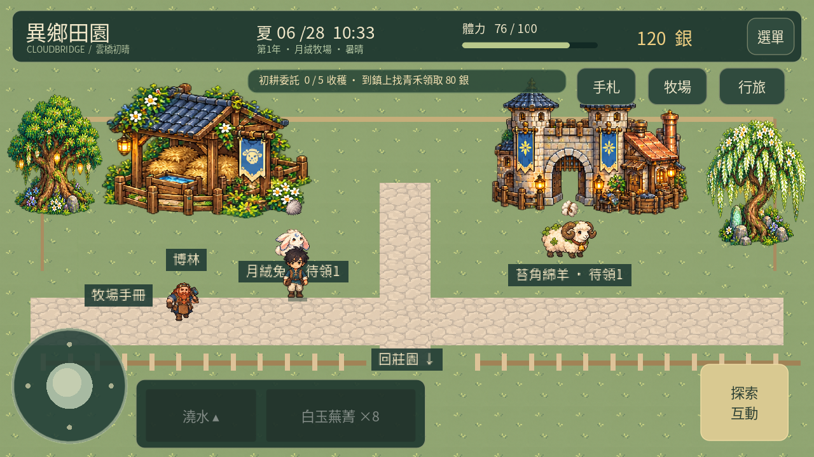

# 0.27「雲橋日常」

本輪依使用者授權完成下一階段1–7項。手機實測修正仍暫緩，上架準備不在本版範圍。所有角色沿用已通過造型；沒有加入新的未審角色、場景或道具設計。

## 1. 九名居民四向步態

補齊青禾、洛安、雷恩、莉莉雅、博林、雲霽、青麟，七張原創透明圖集，每張前、左、右、後各4幀，共112個正式圖格。連同0.26的艾德里克、素月，九名居民都有四向行走圖與停留時的呼吸動作。主角仍維持八方向。

角色移動時依實際位移切換方向，停留不播放踏步；雨天留在棲地時也不踏步。雷恩、莉莉雅生成圖的左右列經目視校正後登記。圖集以alpha輪廓、頭部中心及腳底定位，原PNG不變，Godot匯入限制512px，降低手機紋理與APK用量。[來源與SHA256](resident-walk-provenance-0.27.json)。

以上為使用實際角色繪製器的開發步態檢視頁，沒有放進玩家選單。

## 2. 工作、採買、交流與歇腳

三位鎮民增加午後採買／交換物資路線，原有工作、午間廣場與晚間散步仍保留。六位聚落居民由持續小幅左右擺動，改為有工作停留、移動、交流與歇腳的循環，互動頁顯示目前活動。雨天留在原棲地避雨整理。

路線位移使用既有通道，角色不會變成額外碰撞障礙。聚落與棲地仍按時段切換，沒有新增跨地圖交通動畫；交流與工作使用路線、停留及對話狀態呈現。

## 3. 夏季收成用途

| 料理 | 食材各1份 | 恢復體力 |
| --- | --- | ---: |
| 番茄燉蔬 | 番茄、馬鈴薯 | 50 |
| 茄子麥餅 | 茄子、小麥 | 60 |
| 蓮藕香茶 | 蓮藕、香草 | 55 |

在農舍爐灶的第10–12道食譜製作。沿用既有料理分類圖示，沒有新增未審菜餚美術。食材不足不部分扣除，成品可攜帶食用，不參與出貨。

夏季公告牌以六日循環交替出現原有三單與新三單；接單後可跨日、跨季完成。每日最多完成一單：

| 委託 | 需要 | 報酬 |
| --- | --- | ---: |
| 茶館的夏日燉蔬 | 番茄2 | 165銀、青禾好感1 |
| 工坊的午間便當 | 茄子1、小麥1 | 145銀 |
| 行商的清池茶料 | 蓮藕1、香草1 | 135銀 |

青禾喜歡番茄、雷恩喜歡茄子、素月喜歡蓮藕；送禮沿用每日一次限制。禮物選單由四頁延伸為五頁，原有物品順序保留。節慶可使用夏季收成的功能延續0.26。

## 4. 養殖日常

八種生物增加覓食、散步、歇腳、晚間休息與靠近玩家時的反應；產物可領取時持續顯示對應產物圖示。餵食、照料、收取仍由原有規則結算，觀看動作不會產生物資或好感。兔子跳動、蜂群浮動、魚池漣漪與幼體比例保留。

## 5. 農舍生活

實際木箱新增四頁收成收納，每次存入或取回1／5份。箱內物品不參與出貨、料理、送禮或委託，必須取回行囊使用；這個箱子不等同於提升出貨收入的莊園保鮮貨架。存取數量守恆，容量不足整次取消。

走近茶桌可每日小歇一次，消耗20分鐘，恢復最多8體力；體力已滿或太晚時不消耗時間。每日記錄隨存檔保留，重開不能再領一次。茶桌也提供青瓷木居、暖麥晨光、月葉清居三種配色，家具位置和碰撞通道保留。

## 6. 畫面與動線

九名居民統一世界高度與腳底定位，博林保留矮人較矮的體型。牧場主通道改用與小鎮一致的安靜暖石材，側緣使用低紋理草地；小鎮廣場增加柔和苔色收邊，減少地面與角色搶色。農舍木箱、茶桌使用實物互動區，入口、家具及爐灶通道經導航檢查。

## 7. 驗證與數值

新料理保留食材成本與體力取捨，新季節單相對直接出貨約增加18%–23%報酬（香草另計採集成本），每日完成次數限制不變。水槽、作物成熟與售價維持0.26；未發放新種子、免費收成或免費建築。沿用兩種56日經營策略回歸，該模擬不包含實際路程與時鐘，不代表手機實測。

專項檢查包括舊版存檔、物品守恆、存取容量、出貨排除箱內物品、料理食材與體力、新委託防重領、新送禮每日限制、每日小歇存檔防重領、所有圖格與手機紋理尺寸、九名居民路線與農舍導航及版面。完整結果見[測試紀錄](validation-0.27-tests.json)。

新增`home`欄位可省略；舊存檔預設空箱、原配色、未小歇，新料理數量補0。原有田地、金錢、庫存、主線、設施與關係保留。新增欄位沿用原子存檔、備份與匯出碼驗證。

[18.83秒實際Godot渲染影片](living-0.27-gameplay.mp4)。截圖與影片使用獨立展示存檔、桌面Godot觸控介面，不能代表實體手機效能。這次未連接手機或模擬器。
