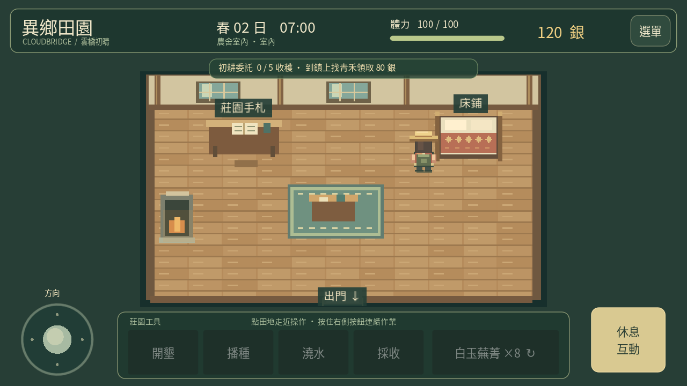
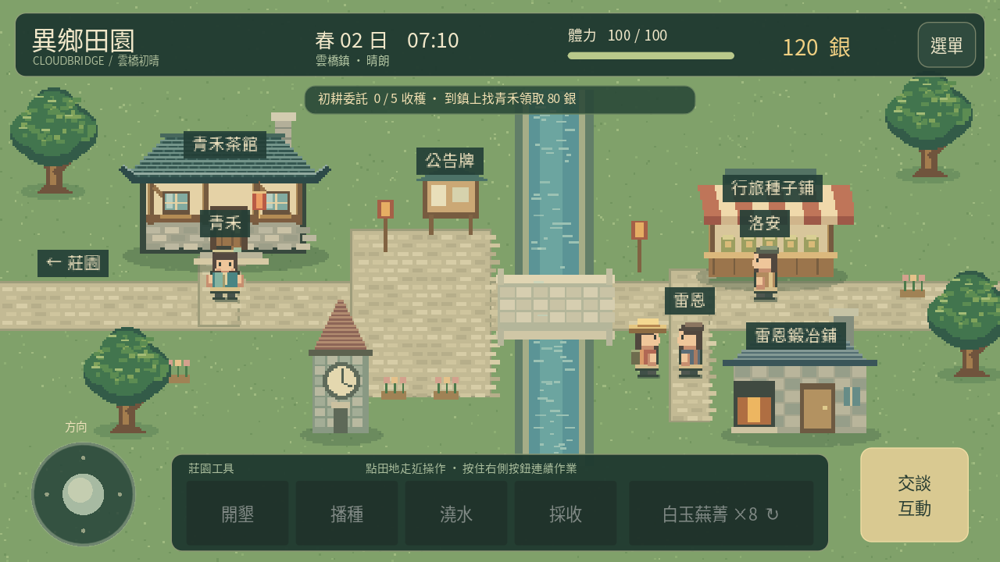

# 地圖與行旅（更新至 0.9）

五張地圖使用同一組農場進度與遊戲時間。點建築、居民或出入口會自動走近互動；也可用搖桿／鍵盤走近，再按互動按鈕。

| 區域 | 入口與返回 | 目前內容 |
|---|---|---|
| 雲棲莊園 | 東路往鎮上，左側農舍門口進屋 | 原有 28 格田地、出貨箱與種子攤，南側圍欄可用木材和石料修復；農舍南側有烘乾架，水井南側新增雞舍與母雞活動區 |
| 農舍室內 | 南側門口回莊園 | 右上方床鋪睡到翌日；左側手札查看累計收成、出貨收入與青禾好感，爐邊煮草茶恢復體力，手札查看居民委託紀錄與重讀茶會 |
| 雲橋鎮 | 西側道路回莊園，東側道路往霧杉林 | 茶館青禾、公告牌、石橋、種子商人洛安、鐵匠雷恩與鐘樓；公告牌可接委託，居民本人確認交付 |
| 霧杉林 | 西側道路回雲橋鎮；修好東側驛路後往遺跡 | 每日八處枯枝、石料與霧香草採集點，霧泉與古道景觀 |
| 星潮舊驛 | 西側道路回霧杉林 | 雙語碑文、星紋石台與一次性發現事件 |

青禾在小鎮茶館前，沿用每日一次好感與五份採收後的 80 銀初耕獎勵。莊園的茶亭供歇腳，不再放置青禾。商人使用原有種子價格與庫存系統；鐵匠目前提供故事對話，尚未提供工具升級。小鎮建築目前為戶外互動，農舍是本版可進入的室內。

睡眠恢復體力、推進日期與已澆水作物成長，醒來位於農舍床邊。晚上 22:00 自動回農舍休息。雨天室內不顯示雨絲，戶外環境聲變小；農場天氣與成長仍照常運作。在農舍或小鎮不會耕作，工具列顯示停用。

切換區域會清除舊尋路、待辦互動與觸控狀態，重建碰撞尋路網格並儲存。入口與出口分開，並有短暫互動冷卻，避免連續跳轉。河道只有石橋可通過，室內家具與牆壁會阻擋移動。

存檔維持 version 1，新增可選 area（farm／house／town／forest／ruins），與 player 位置一起還原。缺少 area 的舊存檔預設 farm，保留所有作物、金錢、庫存及關係資料。不正確的區域值會依現有損壞存檔流程處理；有效位置若落在新地圖障礙物內，則改從入口繼續。沒有進行降版安裝測試。

[觀看 0.4 實際引擎示範](travel-0.4.mp4)。這些畫面由桌面 Godot Compatibility renderer 產生；Android 實機啟動、更新安裝與操作手感尚待驗證。

0.5 林地、每日資源與修復規則詳見 [林地採集](FORAGING.md)。

0.6 烘乾架的建造、批次及成品出貨規則見 [加工與出貨](PROCESSING.md)。架體會阻擋行走，初次讀取舊檔若位置落在新障礙物內，會依原有規則回到安全入口。

0.7 公告牌委託與青禾茶會詳見 [居民與相識](RESIDENTS.md)。商店與居民原有對話仍可從交付視窗進入。

0.8 雞舍在水井南側，從左邊操作點接近。舊推車和花盆位置調整為雞舍位置；雞舍占地會阻擋行走，舊存檔若正好站在新障礙物中，會依既有規則回到安全位置。領蛋與餵食在雞舍外的管理視窗進行，沒有新增室內地圖。詳見 [雞舍與養雞](LIVESTOCK.md)。

0.9 遺跡入口與主線條件見 [驛路與遺跡](EXPLORATION.md)。未修復時林地東界阻擋行走；修好後重建尋路，遺跡入口與林地返回點都避開自動互動範圍。

0.10 在莊園池塘、林地霧泉與遺跡星泉加入釣點，均可點水面或標籤走近互動；既有水面仍不可通行。遺跡釣魚須先修復驛路。詳見 [釣魚玩法](FISHING.md)。

0.11 農舍原草茶標籤改為「爐灶」，互動後可選草茶、料理食譜及料理背包。沿用同一操作點，沒有新增碰撞或室內區域；詳見 [料理玩法](COOKING.md)。
