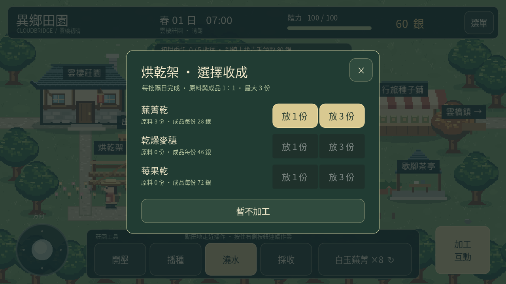
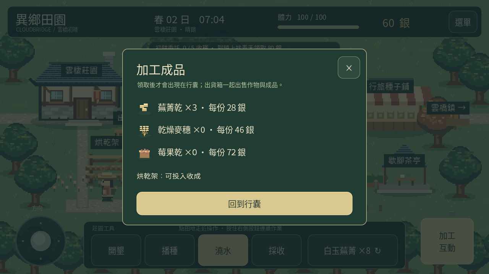

# 0.6「暖風工坊」

烘乾架在農舍南側。點「建造烘乾架」，準備木材 4、石料 2、60 銀後確認建造；只需建造一次。材料或金錢不足時不扣除任何資源。

架子空著時可選 1 或 3 份相同收成，投入後立即扣除原料。種子不能加工；不額外消耗體力。一座架子同時只有一批作物，必須領取後才能再次投入。

| 收成 | 成品 | 原作物售價 | 成品每份售價 |
|---|---|---:|---:|
| 白玉蕪菁 | 蕪菁乾 | 18 銀 | 28 銀 |
| 金穗小麥 | 乾燥麥穗 | 32 銀 | 46 銀 |
| 燈籠莓 | 莓果乾 | 48 銀 | 72 銀 |

原料與成品數量 1：1。每批在遊戲日期進入隔天時完成，睡一晚或夜深自動回家都會推進加工。雨天照常運作，暫停選單、離開遊戲或重新載入不會提前完成。這版沒有現實時間等待或離線加速。

回到架上按「領取成品」，成品才進行囊。成品留在架上不會過期；即使隔幾天才來也不會遺失。背包的「成品雞蛋」頁顯示已領數量、單價與架子狀態。出貨箱一次出售全部作物與已領成品，林地素材與架上未領批次保留。

例如三份蕪菁可直接出貨 54 銀，或放入架子、睡一晚、領取三份蕪菁乾後出貨 84 銀。建造仍需先支付材料與 60 銀，不是立即回本的免費升值。

存檔沿用版本 1，新增可選 rack_built、goods、processing_job。0.5 及更舊資料缺少欄位時預設尚未建造、空成品及空批次；原有農田、素材、圍欄、金錢、好感與區域進度保留。存讀檔會檢查配方、批量、日期與架子狀態，避免不完整批次被接受。

本版也修正林地出口文字點擊範圍、鎮東林地標籤範圍、背包素材按鈕高度，以及日期／體力／銀幣等整數欄位對小數的拒絕驗證。加工讀檔則接受 JSON 中的整數數值，即使解析器以浮點數表示。

[觀看引擎示範](processing-0.6.mp4)。示範安排起始材料與收成以縮短影片；實際建造、睡眠、領取與出貨使用遊戲流程。Android 實機安裝與觸控效能仍待確認。
