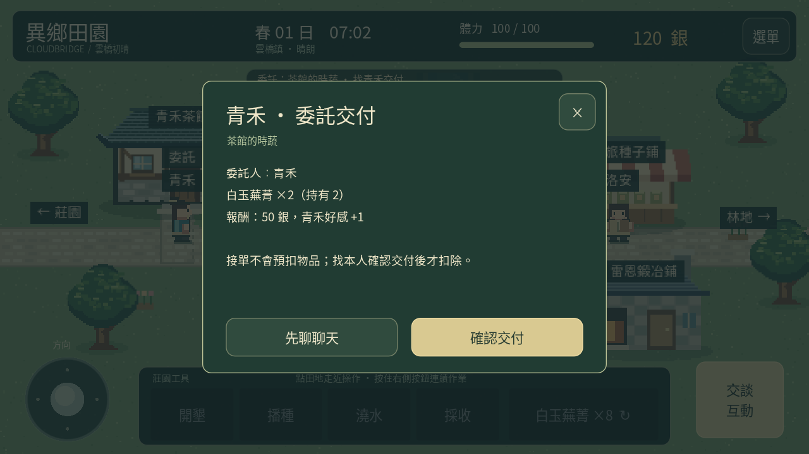
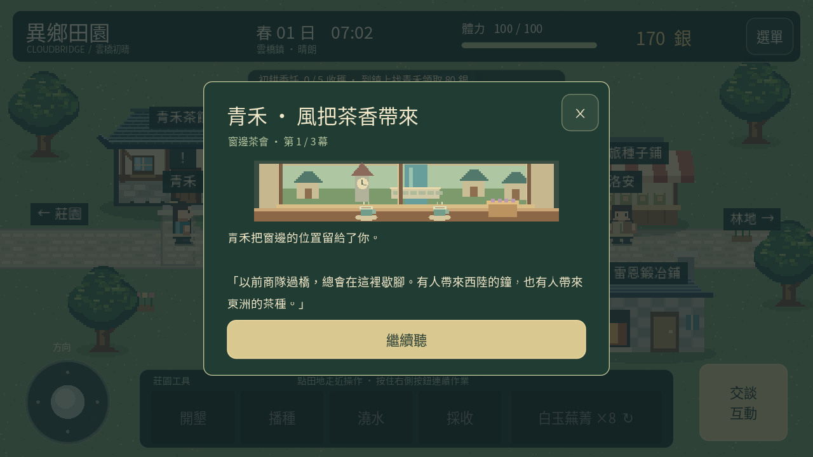

# 0.7「橋畔人情」

小鎮公告牌會張貼居民委託。點公告牌先查看需求與報酬，再按「接下委託」；同時只能接一件，每天最多完成一件。每天的張貼按三日循環，從春 1 日開始：

| 輪替 | 委託人 | 需求 | 報酬 |
|---|---|---|---|
| 第 1 日 | 茶館青禾 | 白玉蕪菁 2 | 50 銀、青禾好感 +1 |
| 第 2 日 | 鐵匠雷恩 | 木材 4、石料 2 | 50 銀 |
| 第 3 日 | 商人洛安 | 已領取的莓果乾 1 | 100 銀 |

接單不會預扣或保留行囊物品，也沒有當日完成期限。已接委託跨日保留，直到完成或在公告牌確認放棄；放棄不扣物品、銀幣或好感。未接的公告會隨日期輪替，放棄後顯示今天的公告。

備齊後找委託本人，視窗會列出需求、持有數量及報酬，按「確認交付」才扣除物品並發獎。物品不足或找錯人不扣除任何資源。原有交談與種子商店仍可使用。出貨不等於交付；未領取的加工批次也不能交給商人。

完成後，當天不能再接其他委託；睡一晚才可再完成下一件。重新載入不會重置限制或重複發獎。委託報酬增加銀幣，不計入出貨收入或初耕的五份作物採收；原本的初耕獎勵仍獨立運作。雷恩與洛安目前沒有獨立好感度。

青禾好感達 3 後，在茶館前交談可選「赴窗邊茶會」。三幕原創對話配合窗景插圖，完成最後一幕後獲得霧香草 2、好感 +1，並記入手札。中途關閉不領獎，下次可從第一幕再看；獎勵只發一次。

完成後，到農舍書桌打開「莊園手札」可查看居民委託完成數、好感與茶會狀態，並重讀茶會。重讀不改變好感、物品與進度；不是可重複領獎的事件。此版尚未加入戀愛、居民作息或其他個人事件。

版本 1 存檔新增可選 active_request、request_completed_day、requests_completed、tea_event_seen。舊資料缺少時預設無委託、完成數 0、未看茶會；原有進度保留。已達 3 好感的舊玩家可直接與青禾交談，開啟新事件。

[觀看實際引擎示範](residents-0.7.mp4)。示範安排起始收成與既有好感以縮短影片，其餘接單、交付與事件使用正式流程。手機實際安裝、操作及更新保留資料仍待驗證。
