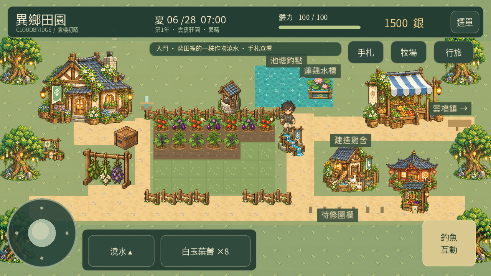
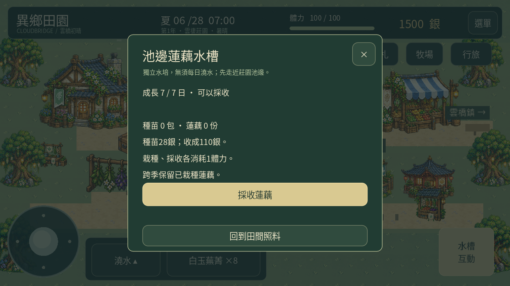
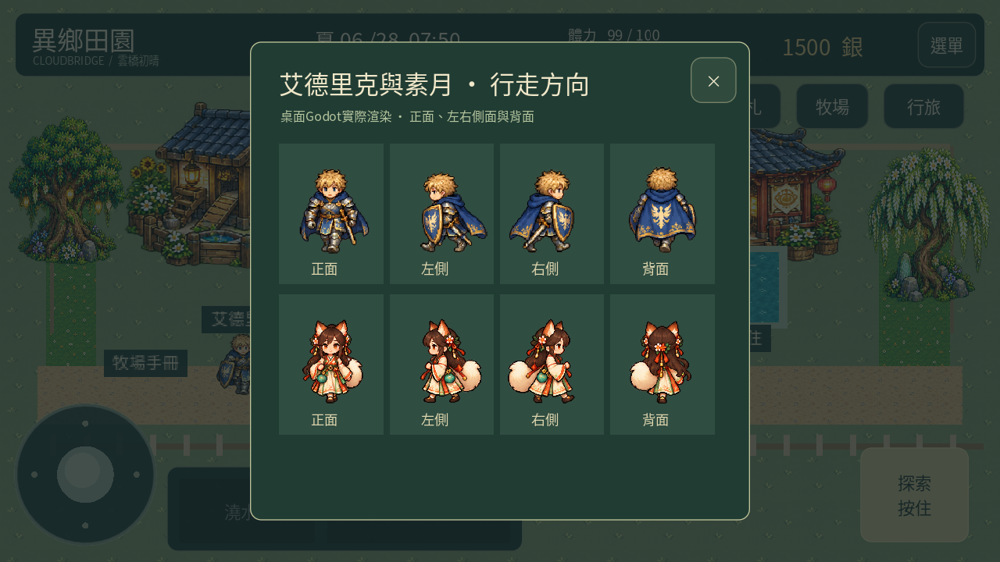

# 0.26「清池夏苗」

提案04經使用者明確通過後，製作正式圖集並整合。延續0.25的莊園經營功能；手機實測修正按使用者要求暫緩，上架準備未開始。

## 已加入

| 作物 | 種苗單價 | 成長 | 收成售價 | 栽培方式 |
| --- | ---: | ---: | ---: | --- |
| 朱果番茄 | 20銀 | 5個有澆水的夜晚 | 70銀 | 原田地 |
| 紫玉茄子 | 24銀 | 6個有澆水的夜晚 | 90銀 | 原田地 |
| 清池蓮藕 | 28銀 | 7個夜晚 | 110銀 | 池邊獨立水槽，自動蓄水 |

夏季（第29–56日，之後每56日循環）購買新種苗、開始栽種。商店每次買3包，價格按3包顯示。換季保留種苗與已種植作物；原有八種作物維持原規則與夏季加成，新番茄、茄子不套用額外加速。三種新作物均有幼苗、成長、開花、成熟及收成圖示。

走近莊園池塘右側，點「蓮藕水槽」或按互動。水槽需木材6、石料4、90銀，確認才扣除；栽種、採收各耗1體力，一次收1份，不會每日重複產出。未走近時，可從手札→經營總覽→田間照料→蓮藕水槽查看狀態，無法遠端施工或收成。

新作物接入行囊、四頁種子鋪、旱田播種選單、出貨確認清單與節慶供品。蓮藕不出現在旱田播種選單，也不能經由存檔塞進旱田。固定28格田地與三處設施位置保留，池邊新互動沿用既有通道。

三種設施正式換成分流水槽、照料工作檯、保鮮貨架；功能與占位保留，不需拆除重建。

艾德里克、素月採用正面、左側、右側、背面各4幀行走圖，巡行時依實際移動方向切換，停下有呼吸動作。以角色輪廓登記圖格、頭部中心與腳底定位，避免狐尾或披風改變定位。這次完成2名居民的四個主要方向；其他7名居民沿用原素材與既有動態。主角八方向移動保留。

## 存檔與驗證

舊存檔的新作物庫存補0、水槽預設未建造，沒有額外贈送種子或自動施工。主線遺跡獎勵仍是原八種春季種子各3包。新增水槽使用可省略欄位；正式存檔、備份、匯出碼、讀回均沿用現有驗證流程。

`tests/test_summer_art.gd`檢查夏季購買/播種限制、精確成熟日數、舊存檔遷移、水槽建造與重複扣款防護、七日生長、存檔重啟、跨季保留、旱田拒絕蓮藕、重複採收防護、實際出貨結算、圖集範圍與手機版面。完整測試另含所有場景、六種設施設定的導航、桌面與觸控完整流程及12個音訊檔。

[實際Godot渲染影片](summer-0.26-gameplay.mp4)。使用獨立展示存檔，畫面中的成熟田地、設施與金錢不是新遊戲贈送。步態檢視頁僅為開發展示，不是玩家選單。畫面以桌面Godot的觸控介面渲染，不能代表手機FPS或實體手機測試。

## 美術來源

四張正式PNG由image_gen依已通過提案04製作，原檔保留於`assets/pixel/summer/`，沒有用程式清除背景、重繪或縮放PNG。`tools/register_summer_art.py`只讀取alpha輪廓並輸出Godot圖格座標；Godot使用匯入尺寸上限（作物1024、設施1024、艾德里克768、素月1024）減少手機紋理記憶體與下載體積，取圖座標依實際匯入尺寸換算，原PNG不變。

艾德里克生成稿包含額外斜向試作列，尚未採用，正式程式只使用核對過的前4列。沒有宣稱九名居民已完成八方向圖集。概念稿上的「DRAFT」保留作原始審核紀錄，通過狀態見[提案04](design-review-04/README.md)。
