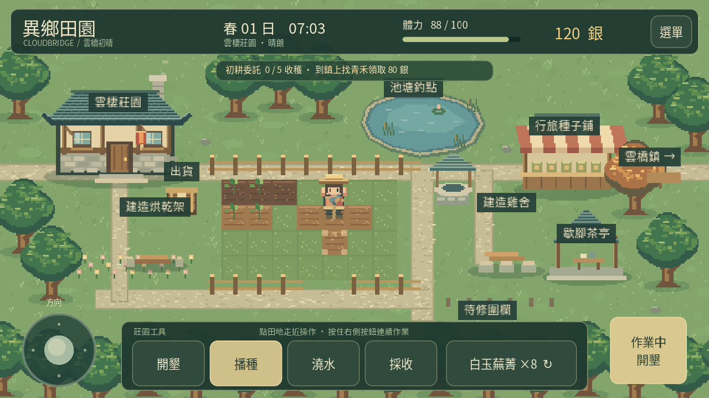

# 0.12 田間步調

開墾、播種、澆水與採收成功後，角色會站定完成約 0.30 秒的工具動作。這段時間固定位置與面向，右側按鈕顯示「作業中」及正在使用的工具。

## 操作

- 搖桿或方向鍵可繼續按住；這一動作結束後恢復移動。結束當下的畫格維持站定，避免低幀率時一步跳出過遠。
- 動作期間點地面或田地，會記住最後一次點擊，完成後才走向目標。連點不會累積長串指令；未出發前也不扣體力或種子。
- 可以提前切換下一件工具或種子；正在揮動的工具不變，到下一目標時才使用新的選擇。
- 右側按鈕仍可長按，配合左手搖桿在動作間移動；已澆水、已開墾、未成熟或缺種子的田地不會重複扣資源。
- 資源不足或無效操作不開始站定動畫，仍可立即移動。

## 結算與中斷

成功操作仍在按下或走近目標時立即結算一次，並立即存檔。0.30 秒是動作展示與移動限制，結束時不再扣料或發收成。

開選單、切到背景、失去焦點、進入其他區域或夜深睡眠會清除動畫及尚未執行的點擊，不退回已成功的操作，也不再次發放物品。背景恢復後停在選單；關閉選單後需重新點擊目的地，已清除的指令不會自動重播。

存檔維持版本 1，沒有新增持久欄位。僅保存既有田地、體力、庫存與位置，動作進度和排隊點擊不寫入存檔。重開可立即操作，不會卡在作業中。

遊戲日鐘在田間動作期間照常走；只有原有對話及選單規則會暫停時間。

## 實作與驗證

tool_action.gd 管理單次動作的時間、工具、目標及面向快照；game.gd 負責輸入、移動限制與中斷。實際場景由同一個時鐘推進角色動畫，避免世界節點再次累加造成動作與站定不同步。單獨展示圖集時仍可自行播放。

新增 66 項檢查，各以桌面與手機介面執行，涵蓋四種工具、鍵盤與搖桿、第二指長按、下一目標實際到達並播種、連點防重入、缺料、無效目標、背景、選單、切區、夜深、立即存檔與讀取後不重播，另確認林地採集動畫仍正常推進。原有跨日種植與其他玩法持續由完整場景驗證。

[觀看實際引擎示範](actions-0.12.mp4)。示範安排初始位置與一塊待播空田；為展示採收姿勢，僅在採收前將展示作物設為成熟，其餘輸入、排隊、結算、中斷及出貨均使用正式流程。正常跨日成長另由完整場景驗證。

這次是依專案原始碼檢查做出的操作改善，未引用尚無法取得的 B站或 Udemy 課程內容。Android 模擬器與實體手機仍未安裝執行，實際手感、儲存延遲與效能待實機確認。
