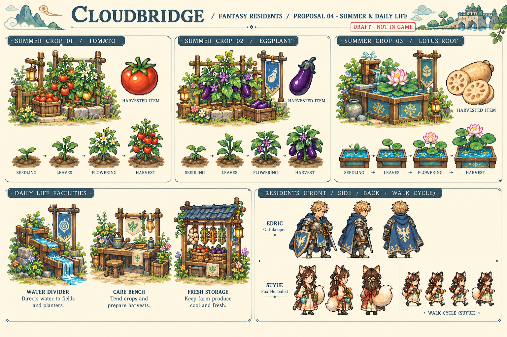

# 提案04：夏季與日常生活（已通過）

使用者於2026-10-21明確回覆「通過，可以繼續」。正式圖集與功能已整合至[0.26](../SUMMER_026.md)；本頁保留原始概念稿作審核紀錄，概念板本身不放入APK。0.25仍保留舊素材。

- 夏季作物：番茄（支架栽培）、茄子（矮叢）、蓮藕（獨立栽培水槽，不直接塞進旱田）。每種需幼苗、成長、開花、成熟及收成圖示。
- 初步數值提案：番茄種子20／5照料日／售70；茄子24／6日／售90；蓮藕28／7日／售110。0.26已按上述數值加入商店與存檔。
- 設施外觀：分流水槽、照料工作檯、保鮮貨架。木石、青瓷、藍瓦的色系承接通過的莊園；正式版需按固定施工格尺寸縮減裝飾。
- 居民方向圖：先示範艾德里克、素月的前側背面與素月四姿步態，核對披風、盾牌、狐尾輪廓。圖中不是完整九位居民八方向圖集；0.26已先完成這兩名居民各四主要方向、每方向四幀；其他居民後續逐位製作。

風格沿用提案02；全部原創，東西方奇幻共存。此圖為概念稿，比例、步態與像素規格仍需正式製作，不可直接當作行走sprite sheet。

0.27已補齊其餘七名居民，九名居民皆有四主要方向步態，詳見[雲橋日常](../LIVING_027.md)。
