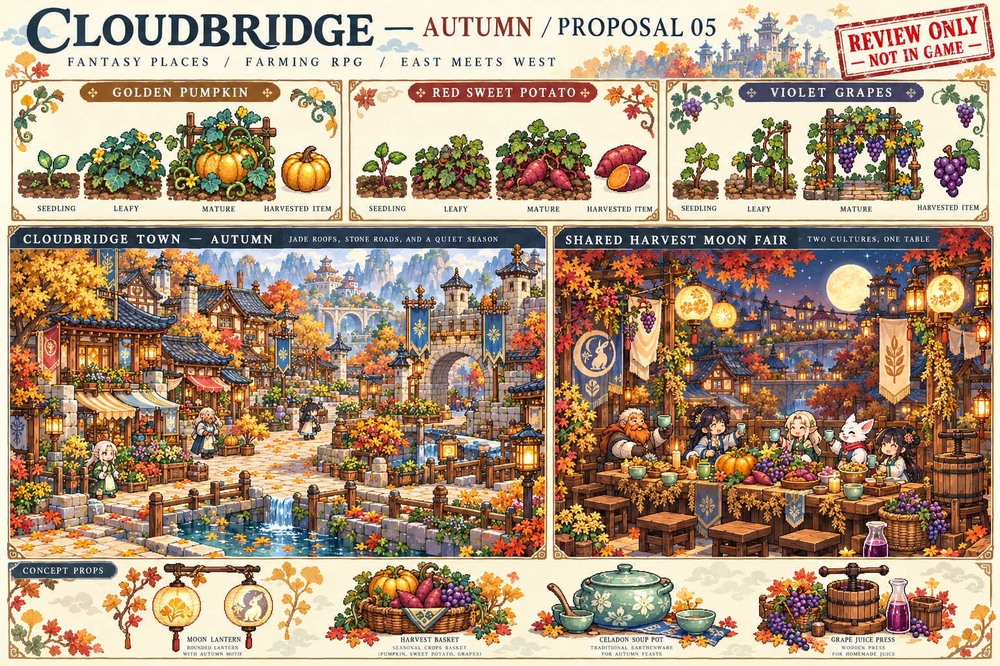

# 提案05：秋季與共收月會（待審）

本提案供使用者審閱，**未加入遊戲資產、商店、季節日曆或APK**。0.28仍使用既有春夏循環；秋季必須在設計通過後再製作正式圖集與季節遷移。

| 候選作物 | 種苗價 | 照料夜晚 | 收成售價 | 初步規則 |
| --- | ---: | ---: | ---: | --- |
| 金栗南瓜 | 40 | 8 | 140 | 藤蔓收在單格可讀範圍 |
| 紅心甘薯 | 26 | 6 | 90 | 低矮葉叢與橙心塊根 |
| 紫露葡萄 | 45 | 9 | 160 | 緊湊支架，初期單次收成，再生另議 |

數值為候選設計，不是遊戲已實裝數值。正式製作需幼苗、成長、開花、成熟與收成五格，不能直接裁切概念板當作圖集。

場景沿用唐宋木構、青藍瓦與西方石拱，加入金色銀杏、局部紅葉與稀疏落葉；道路仍保持低紋理與清楚動線。概念稿節慶區較濃的暖色會在正式場景降低飽和度，保留人物辨識度。

節慶方向為「共收月會」：中方月燈與西方麥穗飾物共同布置長桌，收成交換、食譜分享與居民選擇事件相連。候選道具為月燈、收成籃、青瓷湯鍋與葡萄汁壓榨器；全部待審，不會提前加入遊戲。

秋季若通過，另需規劃春夏存檔日期如何遷移到三季或四季年，確保已排程委託、作物、成長日數與每週紀錄不被重置；本輪先保留既有日期規則。
